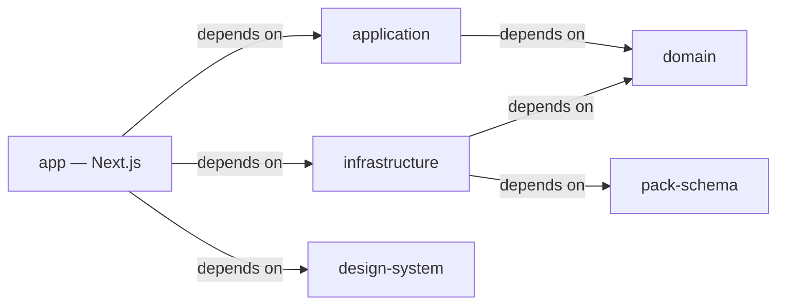

# ADR-001 — Module Strategy: Turborepo Package Boundaries

**Status:** Frozen v1.0 · Approved
**Scope:** Whether the four Clean Architecture layers live as folders in one Next.js `src/`, or as separate Turborepo packages.
No exact package names or folder layout yet — that's the Folder Structure document, decided after this one.

## Contents

- [Context](#context)
- [Decision](#decision)
- [Alternatives Considered](#alternatives-considered)
- [Consequences](#consequences)
- [Status](#status)

---

## Context

The [Architecture Blueprint](../architecture/architecture-blueprint.md) (frozen v1.0) defines four layers and a Dependency Rule between them, plus seven rules in its Decision Log (AD-01–AD-07) — "Domain imports nothing," "a Server Component must never contain business logic," and so on.
Every one of those is currently enforced by a developer remembering a document, not by anything that fails a build.

The [Pack Specification](../architecture/pack-specification.md) (frozen v1.0) adds a second, sharper requirement: its schema must be able to evolve independently from the Domain Model — stated explicitly as a goal, not inferred.
That independence needs an enforcement mechanism too, or it's just a sentence in a document, the same way the Dependency Rule was before this ADR.

The tech stack (Next.js App Router + Turborepo) is already fixed by the project brief.
The open question this ADR answers: does Turborepo host one app package with everything inside its `src/`, organized by feature — or does each architectural boundary get its own package?

## Decision

Each Clean Architecture layer — plus two cross-cutting concerns the last two documents introduced — becomes its own Turborepo package.
Package boundaries are the enforcement mechanism for the Dependency Rule, not a naming convention inside one app.

| Package | Holds | Depends on |
|---|---|---|
| `domain` | Entities, Value Objects, Repository interfaces, Domain Services | Nothing |
| `application` | Use Cases, Request/Response Models | `domain` |
| `infrastructure` | Repository implementations, filesystem/Zip/Id/Clock adapters, the `PackExporter` implementation | `domain`, `pack-schema` |
| `pack-schema` | The Pack Specification's own types — manifest, content, vocabulary shapes | Nothing |
| `design-system` | shadcn/ui-based components, design tokens (color/type/spacing/radius/elevation/motion/icon-size) | Nothing |
| `app` (Presentation) | Server/Client Components, Server Actions, Route Handlers, the Composition Root | `application`, `infrastructure`, `design-system` |

`pack-schema` is deliberately its own package, not folded into `domain` or `infrastructure`.
That's a direct consequence of the Pack Specification's own requirement: if Pack types lived inside `domain`, "evolves independently" would be fiction — any file in `domain` could reach into Pack shapes and vice versa, and a Pack-only change would show up in every diff that touches `domain`.

Note who doesn't depend on it: `application` never imports `pack-schema` — it only ever calls the opaque `PackExporter` port and gets back an artifact reference, exactly as specified in the Architecture Blueprint's `BuildLanguagePack` walkthrough.
Only `infrastructure`, which implements that port, needs to know the schema's actual shape.

## Alternatives Considered

### A. Single `src/`, feature-first — Rejected

One Next.js app, organized by feature (`src/features/lessons/`, `src/features/courses/`...), each folder internally layered by convention.
Simplest possible setup — one `package.json`, one build, fastest to start.

1. **The Dependency Rule becomes unenforceable.** Nothing stops `src/domain/lesson.ts` from importing `next/navigation` — TypeScript and the bundler allow it freely. The only thing preventing it is a developer remembering AD-01. A package boundary makes it a compile error instead: `domain`'s `package.json` simply doesn't list `next` as a dependency.
2. **Domain and Application can't be tested in isolation.** Their unit tests still boot the Next.js/React toolchain around them, or need careful test-config surgery to avoid it — slower feedback, and it undersells the actual claim that Domain has zero dependencies.
3. **The Pack Specification's independence has no enforcement mechanism.** Without a separate `pack-schema` package, "evolves independently from the Domain Model" is just a sentence — any file under `src/domain/` can reach into Pack types and back, and nothing stops it.
4. **Weaker preparation for Sayva ML Studio.** The project brief already anticipates a third product in this ecosystem. A `domain` or `pack-schema` package that's already independently built is trivially reusable later; code buried in one app's `src/` is not.

### B. Packages by feature, not by layer — Rejected for v1

e.g. `packages/lessons`, `packages/courses`, `packages/signs` — each a vertical slice containing its own mini Domain/Application/Infrastructure. A legitimate pattern at larger scale.

Not right for where Sayva Studio's aggregates actually are today.
The Architecture Blueprint's own `DeleteCourse` example already shows a single workflow reaching across Course, Category, and Lesson repositories; Lesson use cases routinely touch Asset and Sign too.
Slicing by feature this early would trade one coupling problem (layers mixed in one `src/`) for a worse one (constant cross-package dependencies between `lessons`, `courses`, and `signs`).
Worth reconsidering only if the product grows enough independent feature teams to justify the isolation — not a v1 concern.

## Consequences

**Gained:**

- AD-01–AD-07 stop being rules a reviewer has to remember — a disallowed import fails the build.
- PS-01–PS-05's schema independence gets the same enforcement, via the `pack-schema` boundary.
- `domain` and `application` unit-test with zero Next.js/React/DOM overhead — faster, purer.
- A future Sayva ML Studio integration point already exists as a package boundary, not a refactor waiting to happen.

**Cost:**

- More upfront tooling than one `src/` app — a Turborepo pipeline, per-package `tsconfig`/`package.json`, workspace wiring.
- A change that genuinely spans every layer (a new field, say) ripples through more files, each in a different package.

The cost is judged worth it because it isn't optional scope — it's the enforcement mechanism for engineering rules already fixed as non-negotiable ("never couple business logic to Firebase or browser APIs," Repository Pattern, swappable persistence).
This ADR doesn't add new architecture; it makes the architecture already frozen actually hold.

**Explicitly not decided here:**

- Exact package names, or whether `app` is really called `app`.
- Folder layout inside any package.
- Build tooling specifics (bundler, test runner config, TS project references wiring).
- Shared tooling packages (`tsconfig`, `eslint-config`) — standard Turborepo scaffolding, not architecturally interesting enough to belong in this ADR.

## Status

**Approved and frozen (v1.0).**
This is the reference the Folder Structure document is built against, together with [ADR-002](./ADR-002-dependency-rules.md).
