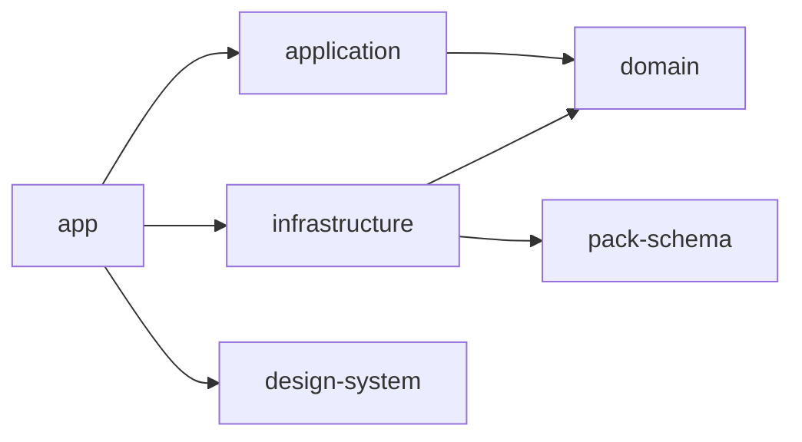

# ADR-002 — Dependency Rules

**Status:** Frozen v1.1 · Approved
**Scope:** Making [ADR-001](./ADR-001-module-strategy.md)'s package graph **enforceable**, not just documented.
Package names below (`@sayva/domain` etc.) are illustrative — final naming is a Folder Structure decision, not this one.
Amended once (DR-14) during Phase 0, Slice 15 — see the changelog at the bottom of this file.

## Contents

- [Context](#context)
- [Decision](#decision)
  - [Dependency direction](#dependency-direction-dr-01)
  - [Allowed dependencies](#allowed-dependencies-dr-02)
  - [Forbidden dependencies](#forbidden-dependencies-dr-03)
  - [Import rules](#import-rules)
  - [Examples — valid and invalid imports](#examples--valid-and-invalid-imports)
  - [Enforcement mechanisms](#enforcement-mechanisms)
  - [Guardrails against drift](#guardrails-against-drift)
- [Alternatives Considered](#alternatives-considered)
- [Consequences](#consequences)
- [Amendments](#amendments)
- [Status](#status)

---

## Context

ADR-001 decided *what* the packages are and, in one table, roughly what each depends on.
It didn't decide how a violation of that graph actually gets stopped.
As written, "the Dependency Rule" is still a sentence a developer has to remember while typing an import — exactly the gap ADR-001 itself was created to close for the Architecture Blueprint's layers.

This ADR closes it at the package level: a specific, named enforcement mechanism for every edge in ADR-001's graph, concrete enough that a violation fails a build or a lint pass rather than waiting to be caught in review.

## Decision

### Dependency direction (DR-01)

The graph is a DAG — a directed, **acyclic** graph.
Every arrow below points toward what a package is allowed to depend on; no arrow may ever point back, even indirectly through a third package.
A cycle (`domain → application → domain`, however indirect) is a violation with no exception, not a judgment call.

### Allowed dependencies (DR-02)

| Package | May depend on |
|---|---|
| `domain` | Nothing — zero packages, zero libraries beyond the language itself |
| `application` | `domain` |
| `infrastructure` | `domain`, `pack-schema` |
| `pack-schema` | Nothing |
| `design-system` | Nothing from this workspace — only React/Tailwind/shadcn primitives |
| `app` | `application`, `infrastructure`, `design-system` |

### Forbidden dependencies (DR-03)

Everything not listed above is already forbidden by omission.
Named explicitly anyway — these are the specific violations most likely to be reached for out of convenience.

| From | To | Why it's tempting, and why not |
|---|---|---|
| `domain` | `application` | Reverse dependency. If Domain seems to need a use case, the logic belongs in a Domain Service instead — and even then, read-only (Blueprint AD-06). |
| `domain`, `application` | `next`, `react`, any framework | Both layers are framework-free by definition (Blueprint §2). A single such import defeats the entire point of the Dependency Rule. |
| `application` | `infrastructure` | Feels convenient when you know exactly which concrete repository you want. The Composition Root exists precisely to remove that temptation (Blueprint AD-05). |
| `application` | `pack-schema` | Only `infrastructure`'s `PackExporter` implementation needs Pack's shape (ADR-001). Application only ever sees the opaque port. |
| `infrastructure` | `application` | Reverse dependency. An adapter implements a port; it never calls back up into a use case, even to "coordinate." |
| `design-system` | `domain`, `application`, `infrastructure`, `pack-schema` | Would break previewability — components must stay driven by plain props, addressable with no business-logic wiring (project's Preview Requirement). |
| `pack-schema` | anything in this workspace | It's meant to stay a pure leaf package — that's what makes "evolves independently" true rather than aspirational. |
| any package | another package's internals | e.g. `@sayva/domain/internal/lesson-factory` instead of the package's public surface. Depending on a package is not permission to reach past what it exports. |

### Import rules

- Cross-package imports always use the package name (`@sayva/domain`), never a relative path that happens to reach across a package boundary on disk (`../../../domain/src/...`) — even where that would technically resolve.
- Within a package, relative imports are normal and unrestricted — this rule is about the boundary, not internal organization, which Folder Structure decides separately.
- A package may only be imported through what it exports publicly. If something is needed from outside that isn't yet exported, that's a decision to widen the package's public surface — not a reason to import its internals directly.
- Prefer `import type` for type-only cross-package references (e.g. Application importing the `LessonRepository` interface shape) — keeps no runtime code pulled in for a reference that's purely structural.

### Examples — valid and invalid imports

| Verdict | Import (illustrative) | Context |
|---|---|---|
| ✅ Valid | `import type { LessonRepository } from '@sayva/domain'` | Inside `infrastructure`, implementing the interface |
| ✅ Valid | `import { CreateLessonUseCase } from '@sayva/application'` | Inside `app`'s Server Action |
| ❌ Invalid | `import { CreateLessonUseCase } from '@sayva/application'` | Inside `domain` — reverse dependency |
| ❌ Invalid | `import { redirect } from 'next/navigation'` | Inside `domain` or `application` — framework leak |
| ❌ Invalid | `import { FileSystemLessonRepository } from '@sayva/infrastructure'` | Inside an `application` use case — bypasses the Composition Root |
| ❌ Invalid | `import { BuildLanguagePackUseCase } from '@sayva/application'` | Inside an `infrastructure` adapter — reverse dependency |
| ❌ Invalid | `import type { PackManifest } from '@sayva/pack-schema'` | Inside `application` — only `infrastructure` sees Pack's shape |
| ❌ Invalid | `import { Lesson } from '@sayva/domain'` | Inside a `design-system` component — must stay prop-driven |
| ❌ Invalid | `import { LessonFactory } from '@sayva/domain/internal/lesson-factory'` | Any package — reaches past the public surface |

### Enforcement mechanisms

Four independent layers, each catching a gap the others leave open — not redundancy, defense in depth.

| Layer | Mechanism | Catches | Doesn't catch |
|---|---|---|---|
| DR-04 | pnpm workspace + `package.json` `dependencies` | An unlisted package can't be imported at all — module resolution fails | Deep imports into an allowed package's internals; nothing at edit time |
| DR-05 | `package.json` `exports` map (dual-condition since DR-14 — `types` → source, `default` → dist) | Deep/internal imports into an allowed package — only the declared public surface resolves | Wrong packages being allowed as dependencies in the first place |
| DR-06 | TypeScript Project References (`composite` + `references`) | Compile-time violations, in correct build order; also gives Turborepo an accurate incremental build graph | Edit-time feedback — only surfaces at `tsc -b` |
| DR-07 | ESLint boundaries rule, reading the DR-02/DR-03 graph from one shared config | Edit-time feedback (before save), independent of build state (DR-14); also catches an unauthorized edge even if someone already added it to `package.json` | Nothing structural — this is the fast-feedback layer, not the backstop |
| DR-08 | dependency-cruiser, run in CI against the whole resolved graph | Transitive/indirect violations and cycles that a single package's own config might miss, independent of build state (DR-14); produces a graph diagram to diff against ADR-001's | Nothing at edit time — CI-only, last line of defense |

All four run in CI on every PR (**DR-09**) — a violation caught by any layer fails the build, not just a local warning a contributor can ignore.

> DR-07 and DR-08's "independent of build state" wasn't true until DR-14 (Phase 0, Slice 15) — see the Amendments section. Before that, both silently passed on a freshly cloned, unbuilt checkout, because their resolvers followed DR-05's `exports` map to `dist/`, which doesn't exist yet at that point.

### Guardrails against drift

- **DR-10 — one graph, not several.** DR-02/DR-03's allowed/forbidden graph is defined in exactly one shared config that the ESLint rule and the dependency-cruiser rule both read. Never copy-pasted per package, so the two can't quietly disagree with each other.
- **DR-11 — a new package or a new allowed edge is an ADR amendment, not a PR.** Widening the graph is exactly the kind of architectural decision the project's own rules already require a decision/reason/alternatives/consequences record for — the same discipline as everything else, not a special case.
- **DR-12 — rule messages cite their own ID.** Every ESLint boundary violation's error message names the specific DR-xx rule it enforces, so a contributor sees *why*, not just *that* — and if they later want to relax it, they know exactly which recorded decision they'd be reopening.
- **DR-13 — the dependency-cruiser graph is a visible artifact, not a hidden pass/fail.** Its generated diagram is compared against ADR-001's diagram on review, so drift is something a human sees, not just something a machine silently blocks.

## Alternatives Considered

Framed as "what if we used only one of DR-04–DR-08's layers" — since that's the realistic simplification someone would propose, not a wholesale different strategy.

### A. ESLint rules alone, no real package split — Rejected

Simulate the boundary with folder-path lint rules inside fewer (or one) actual npm workspace package, skipping DR-04–DR-06 entirely.
This is effectively re-opening ADR-001's own decision, worth closing off explicitly since it's the most likely-sounding shortcut.

Rejected: a lint rule is disable-able inline with a single comment and no other layer would catch it — single point of failure.
It also forfeits everything ADR-001 already decided on independent builds, isolated testing, and a real extraction boundary for Sayva ML Studio.
Real packages aren't optional scaffolding around the lint rule; the lint rule is one layer *of* the packages.

### B. TypeScript Project References alone, no ESLint boundaries — Rejected

Rely on `tsc -b` as the only enforcement.

Rejected: no editor-time feedback — a violation is only visible at full build time.
It's also weaker at catching a specific failure mode: someone adding an unauthorized package as a `package.json` dependency and a matching `references` entry together.
TS references would happily accept that; the ESLint rule checks against DR-02/DR-03's independently declared graph regardless of what the configs currently say, which is exactly the case that matters for drift.

### C. dependency-cruiser in CI alone, nothing local — Rejected

Rely on the whole-repo graph check as the single gate.

Rejected: correct, but catches violations only after code is written and pushed — no local or edit-time signal at all.
Good as the last line of defense (DR-08); poor as the only one.

The decision is the combination, not any one layer — each of DR-04 through DR-08 exists specifically because the alternative above showed what it alone misses.

## Consequences

**Gained:**

- A violation is caught at whichever point in the workflow it's introduced — editor, build, or CI — never only "eventually, in review."
- Widening the graph requires a visible, reviewable change (DR-11) — architectural drift becomes an explicit decision, not an accident.
- Rule violations are self-explanatory (DR-12) — no tribal knowledge needed to understand why an import failed.

**Cost:**

- Four configs to stand up instead of one (workspace deps, exports maps, TS references, ESLint + dependency-cruiser) — more initial setup than any single layer alone.
- A contributor can see an import fail from up to three different tools (TS, ESLint, dependency-cruiser) with three different error formats — mitigated by DR-12's shared rule IDs, but a real onboarding cost worth naming.

> **Explicitly not decided here:** exact ESLint plugin choice, dependency-cruiser rule syntax, and where the shared graph config physically lives are Turborepo Scaffolding decisions — this ADR fixes the graph and the strategy, not the config files implementing it.

## Amendments

### DR-14 — DR-05's exports map: dual-condition (`types` → source, `default` → dist)

- **Decision:** every workspace package's `exports["."]` map splits its conditions: `types` points directly at the package's TypeScript source entry point (`./src/index.ts`); `default` continues to point at the compiled entry point (`./dist/index.js`), unchanged. Static-analysis tooling — `tsc`, ESLint (via `eslint-import-resolver-typescript`), dependency-cruiser (via its TypeScript-aware resolution options) — resolves cross-package imports through `types`, straight to source. Anything that actually executes a package — Node.js at runtime, Vitest, the built Next.js app — resolves through `default`, to compiled output. One `exports["."]` entry, one file, two conditions pointing at two different targets by design.
- **Reason:** discovered during Phase 0 Slice 15's deliberate-failure CI verification. On a freshly cloned, never-built checkout, DR-07 (ESLint boundaries) and DR-08 (dependency-cruiser) both silently passed a deliberately-introduced, unambiguous DR-02 violation — not because either tool is broken, but because both resolve `exports` maps exactly the way Node.js does, and DR-05's original single-condition map (`types`/`default` both pointing at `dist/`) meant *any* cross-package resolution — allowed or forbidden — failed until a build had already happened. Confirmed this wasn't specific to the one violation that surfaced it: a second, non-cyclic violation (`pack-schema` importing `design-system`) sailed through every single pipeline step — lint, dependency-cruiser, check-types, test, build — on a clean checkout. Real GitHub Actions CI only went red at all because that first violation happened to also create a genuine circular workspace dependency, an unrelated failure Turborepo's own graph-cycle detection caught independently.
- **Alternatives considered:**
  - Make `lint` (and CI's `dependency-cruiser` step) depend on a prior `^build` — rejected. This resequences around the gap instead of closing it: enforcement stays coupled to build state, and a contributor running `eslint .` directly on a fresh clone — outside Turbo, outside CI — would still see nothing.
  - Reorder CI so `build` runs before the static-analysis steps — rejected for the identical reason, and it additionally forfeits DR-07's whole stated purpose (edit-time feedback, before a build ever runs).
  - Turborepo's "Just-in-Time Packages" pattern — `exports` pointing only at source, no per-package `dist`/`tsc -b` at all — rejected as disproportionate. It would discard Slice 8's TypeScript Project References and Turborepo's own incremental build caching for every package, a much larger change than this problem justifies.
- **Verification:** confirmed empirically in isolated scratch clones (never on a committed branch) before implementation, not assumed from documentation — with zero `dist/` anywhere in the workspace: ESLint (reconfigured to `eslint-import-resolver-typescript`) resolved cross-package imports via `types` → source and correctly flagged a deliberately-forbidden edge; dependency-cruiser (with `tsConfig` plus explicit `enhancedResolveOptions`) did the same. A legitimate edge continued to resolve and pass cleanly in the same tests — no false positives introduced.
- **Known limitation — TS6305:** `tsc --noEmit` on a package with a real `references` entry (any package with an actual DR-02 dependency — `application`, `infrastructure`, `studio`) still fails on an unbuilt checkout, with `error TS6305: Output file '<dep>/dist/index.d.ts' has not been built from source file '<dep>/src/index.ts'`. This is a *different* check than module resolution — TypeScript's own project-reference consistency validation, which verifies a referenced project's declared build output regardless of whether `exports.types` can already resolve the source directly. It's a documented TypeScript limitation ([microsoft/TypeScript#40431](https://github.com/microsoft/TypeScript/issues/40431)), not a gap in this project's resolver configuration — confirmed by testing a package with zero declared dependencies (`pack-schema`, no `references` entry at all), where plain `tsc --noEmit` passes with zero `dist/` anywhere. **Decision: accepted, not worked around.** `check-types` keeps `dependsOn: ["^build"]` in `turbo.json`, globally, rather than introducing per-package `turbo.json` overrides or a second `references`-free `tsconfig.json` per package just to decouple the 3 packages (`domain`, `pack-schema`, `design-system`) where it would actually be possible — Phase 0 favors simple, predictable infrastructure over optimizing around a compiler edge case. Revisit only if TypeScript changes this behavior, or if a real scalability problem justifies the added complexity.
- **Consequences:** DR-05's "only the declared public surface resolves" still holds — it's now one surface with two condition-specific targets, not two competing surfaces. `packages/eslint-config/boundaries.js` depends on `eslint-import-resolver-typescript` instead of `eslint-import-resolver-node`. `.dependency-cruiser.mjs` gains a `tsConfig` block and explicit `enhancedResolveOptions`. `lint` and CI's `dependency-cruiser` step are now genuinely independent of build state — this was the actual goal. `check-types` and `test` both keep `dependsOn: ["^build"]`, for two different reasons: `test` because Vitest genuinely executes compiled/runtime code (unchanged since Slice 13's TD-02); `check-types` because of the TS6305 limitation above, not because of anything this amendment could fix.

### DR-16 — DR-05's surface admits `./styles`, single-target and deliberately outside DR-14's shape

- **Decision:** `@sayva/design-system` declares a second public export, `"./styles"`, pointing at `./src/styles/index.css`. Unlike `exports["."]`, it is **single-target**: one path, to source, with no `types`/`default` split. The consumer — `apps/studio` — owns the Tailwind and PostCSS processing that turns it into CSS.
- **Reason:** `src/styles/index.css` describes itself as "the single file a consumer imports to get Sayva Studio's visual language", and under DR-05's single-entry surface no consumer could import it. Three causes compounded: the `exports` map declared only `"."`, `tsc -b` emits no CSS so `dist/` never contains a stylesheet, and `apps/studio` had no CSS pipeline at all. Storybook only worked because it wires `@tailwindcss/vite` itself and imports the file by relative path *from inside the package* — a route no consumer can legally take. Discovered by the Phase 2 Project Picker implementation-readiness audit, before any UI code was written.
- **Why this is not a DR-11 amendment by itself:** `studio → design-system` is already an allowed edge. DR-11 governs a new package or a new allowed *edge*; this widens the declared *surface* within an existing edge, which is DR-05's concern. It is recorded here anyway, because a public surface is exactly the kind of thing DR-11 exists to keep visible and reviewable.
- **The DR-14 exception, stated rather than implied:** DR-14 fixed `types` → source, `default` → dist for every package's `exports["."]`. A CSS entry cannot honour that shape and is not expected to. There is no compiled CSS artifact to point `default` at, and Tailwind v4 is source-consumed by design — the consumer's build must see the CSS, and must scan the consumer's own files for the utilities it uses. `./styles` is therefore source-only on purpose, and the exception is scoped to non-TypeScript assets. DR-14's reasoning about static analysis versus execution is untouched: it concerns module resolution for TypeScript, and CSS participates in neither `tsc` nor the boundary resolvers.
- **Alternatives considered:**
  - **Build CSS into `dist` and export that.** Rejected. It contradicts the stylesheet's own stated contract — "`tailwindcss` is a peerDependency, not a dependency: the consumer's build is what processes this file, so the consumer owns the version" — and a pre-built sheet is functionally wrong under Tailwind v4, which scans the *consumer's* source for utility usage. A sheet built inside `design-system` could only contain the utilities `design-system` itself uses.
  - **Deep relative import from the app** (`../../packages/design-system/src/styles/index.css`). Rejected: that is precisely the DR-05 violation this rule exists to prevent, and DR-07/DR-08 would flag it.
  - **Duplicate the token layer in the app.** Rejected: two sources of truth for a layer whose whole point is that it is generated from one.
- **Consequences:** the declared public surface of `@sayva/design-system` is now two entries, and DR-05's "only the declared public surface resolves" holds exactly as before over a slightly larger surface. `apps/studio` gains a Tailwind/PostCSS pipeline and owns the Tailwind version it processes with. Any future package that needs to publish a non-TypeScript asset follows this shape rather than DR-14's.

## Status

**Approved and frozen (v1.2).**
On approval: Folder Structure, then Turborepo Scaffolding, then Initial Project Bootstrap — implementation begins only after the Domain Model, Architecture Blueprint, Pack Specification, ADR-001, and ADR-002 are all frozen.

---

**Changelog**

- **v1.2** — DR-16 added (DR-05's surface admits `./styles`, single-target, a deliberate DR-14 exception for non-TypeScript assets) during Phase 2, approved 2026-09-22 as decision PP-01.
- **v1.1** — DR-14 added (DR-05's exports map: dual-condition, `types` → source) during Phase 0, Slice 15, approved.
- **v1.0** — Initial freeze. DR-01 through DR-13 resolved and approved.

> **Numbering note.** `DR-15` is cited by `design-tokens.json`, `packages/design-system/tooling/generate-tokens.mjs`, `docs/design-system/README.md` and one test as "the canonical generator input" / "the token generator", but no DR-15 entry was ever written into this document. The reference is dangling. DR-16 skips past it rather than claiming a number that already carries a meaning elsewhere; writing DR-15 up properly is a separate documentation task.
