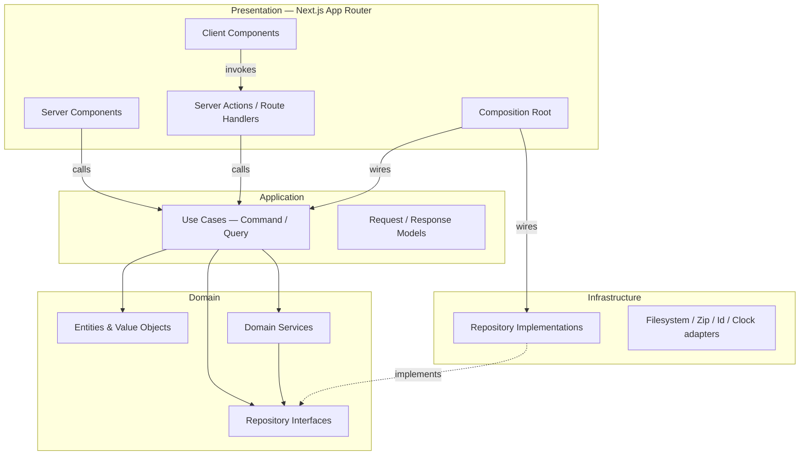
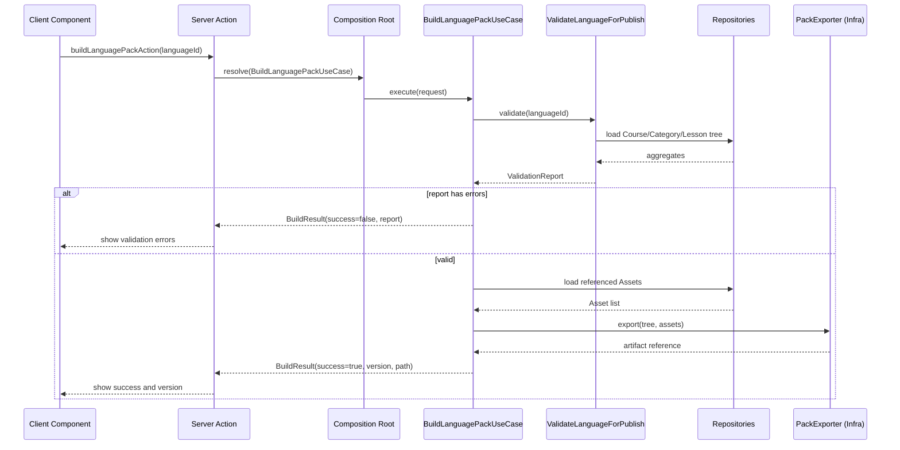

# Sayva Studio — Clean Architecture Blueprint

**Status:** Frozen v1.0 · Reference
**Scope:** Layers, the Dependency Rule, and how Next.js App Router delivers them — built on the frozen [Domain Model](./domain-model.md) v1.0.
No folder structure, no module boundaries, no Pack schema: those are covered by [ADR-001](../adr/ADR-001-module-strategy.md), [ADR-002](../adr/ADR-002-dependency-rules.md), and the [Pack Specification](./pack-specification.md).

## Contents

1. [Layers](#1-layers)
2. [The Dependency Rule](#2-the-dependency-rule)
3. [Domain Layer](#3-domain-layer)
4. [Application Layer](#4-application-layer)
5. [Infrastructure Layer](#5-infrastructure-layer)
6. [Presentation Layer & Next.js App Router Mapping](#6-presentation-layer--nextjs-app-router-mapping)
7. [Aggregate Interaction](#7-aggregate-interaction)
8. [Decision Log](#8-decision-log)
9. [Deferred to Later Phases](#9-deferred-to-later-phases)

---

## 1. Layers

Four layers.
Arrows are the direction a layer is allowed to *know about* another — not the direction requests travel.

**Legend:** solid = calls / depends on · dashed = implements (dependency inversion).

| Layer | Owns | Depends on | Never touches |
|---|---|---|---|
| **Domain** | Entities, Value Objects, Repository interfaces, Domain Services | Nothing | Next.js, React, Node APIs, any framework or library beyond the language itself |
| **Application** | Use Cases, Request/Response Models | Domain only | Next.js, React, concrete Infrastructure classes, HTTP/serialization concerns |
| **Infrastructure** | Repository implementations, filesystem/Zip/Id/Clock adapters | Domain (to implement its interfaces) + external libraries | Application use cases, React, Next.js request/response types |
| **Presentation** | Server/Client Components, Server Actions, Route Handlers, Composition Root | Application (Request/Response Models) + Domain types only for display | Domain entity methods, Infrastructure classes (except inside the Composition Root) |

## 2. The Dependency Rule

Source code dependencies point inward, always.
Presentation depends on Application.
Application depends on Domain.
Infrastructure depends on Domain too — but only to *implement* the interfaces Domain declares, never the reverse.
Domain depends on nothing outside itself.

Infrastructure and Presentation are the two outer layers, and neither may be imported by Domain or Application.
This is what makes "swap local persistence for Firestore later without touching business logic" (a hard requirement from the project brief) actually true rather than aspirational — it's enforced by which imports are allowed to exist, not by discipline alone.

| | Rule |
|---|---|
| ✅ Allowed | Application imports Domain |
| ✅ Allowed | Infrastructure imports Domain (to implement its interfaces) |
| ✅ Allowed | Presentation imports Application |
| ❌ Forbidden | Domain imports anything — no exceptions |
| ❌ Forbidden | Application imports Infrastructure, Next.js, or React |
| ❌ Forbidden | A Server/Client Component imports a concrete Infrastructure class directly |

## 3. Domain Layer

Entities and Value Objects are already specified in the [Domain Model](./domain-model.md) (v1.0) — this section covers what's new at the architecture level: the interfaces Domain declares, and the pure logic that spans more than one aggregate.

### Repository interfaces (ports)

One interface per Aggregate Root, declared in Domain, implemented in Infrastructure.
Domain Services need repository access to check cross-aggregate rules, so the interfaces have to live where the services that use them can see them — see **AD-01**.

| Interface | Key operations | Note |
|---|---|---|
| `ProjectRepository` | findById, findAll, save, delete | — |
| `LanguageRepository` | findById, findAllByProject, save, delete | — |
| `CourseRepository` | findById, findAllByLanguage, save, delete | — |
| `CategoryRepository` | findById, findAllByCourse, save, delete | — |
| `LessonRepository` | findById, findAllByCategory, save, delete | `save` persists the whole aggregate — LessonContent, every ContentBlock, the nested Quiz — atomically |
| `AssetRepository` | findById, findAllByProject, findUnreferenced, save, delete | `findUnreferenced` backs the Orphaned lifecycle state |
| `SignRepository` | findById, findAllByLanguage, save, delete | — |

### Domain Services

Pure logic that no single entity can own because it spans aggregates.
A Domain Service *answers a question* — it may depend on Repository Interfaces only to read what it needs for that answer.
It never orchestrates a multi-step workflow, saves, deletes, or performs any Application-level coordination (**AD-06**); that's the Use Case's job (see §7).

| Service | Answers |
|---|---|
| `ReferentialIntegrityChecker` | Does every AssetReference, SignId, and parent ID in a subtree resolve to a live entity? |
| `OrderingRules` | What's the next SortIndex among these siblings? Are the current ones unique? |
| `PublishGate` | May this Course / Category / Lesson transition to Published? |
| `ReferenceGuard` | Is this Asset or Sign still referenced anywhere? (blocks delete if so) |

> **Deliberately excluded — No Domain Events in v1** (AD-03).
> Nothing in the frozen feature set needs async or reactive side effects — v1 is single-user and synchronous.
> Cross-aggregate reactions are handled inline inside Application use cases for now.

## 4. Application Layer

One Use Case per action.
A Use Case takes a Request Model, orchestrates Domain objects and repositories, and returns a Response Model — plain, serializable data, never a Domain entity (**AD-02**).

**Commands** mutate: they load the relevant aggregate(s), run Domain invariants and Domain Services, persist via a repository, and return a Response Model reflecting the result.
**Queries** read: they may assemble a richer view model from several repositories for the UI's benefit (e.g. a Lesson editor needs its Asset URLs and Sign names resolved, not just IDs) without touching Domain state.

| Aggregate | Representative use cases |
|---|---|
| Project | CreateProject, OpenProject, SaveProject, DuplicateProject, DeleteProject, ImportProject, ExportProject |
| Language | CreateLanguage, UpdateLanguage, ArchiveLanguage, DeleteLanguage |
| Course | CreateCourse, UpdateCourse, ReorderCourses, PublishCourse |
| Category | CreateCategory, UpdateCategory, ReorderCategories, DeleteCategory |
| Lesson | CreateLesson, AddContentBlock, ReorderContentBlocks, RemoveContentBlock, PublishLesson |
| Asset | UploadAsset, RenameAsset, DeleteAsset, ListOrphanedAssets |
| Sign | CreateSign, VerifySign, DeprecateSign, DeleteSign |
| Cross-cutting | ValidateLanguageForPublish, BuildLanguagePack |

### Worked example — CreateLesson (Command, single aggregate)

Request: `{ categoryId, title, description? }` → Response: `{ id, title, sortIndex }`

1. Load the parent Category via `CategoryRepository` — confirms it exists before anything else happens.
2. Construct the Lesson through its Domain factory, which enforces "Title required" unconditionally.
3. Ask `OrderingRules` for the next SortIndex among the Category's existing Lessons.
4. `LessonRepository.save(lesson)`.
5. Map the saved Lesson to a Response Model and return it.

### Worked example — BuildLanguagePack (Command, cross-aggregate)

Request: `{ languageId }` → Response: `{ success, report?, packVersion?, artifactPath? }`

1. Run `ValidateLanguageForPublish` first — it walks the Course→Category→Lesson tree via repositories and runs `ReferentialIntegrityChecker` + `PublishGate` over it.
2. If the report has errors: return `{ success: false, report }` immediately. No side effects, nothing written.
3. If valid: walk the tree (pure Domain logic) to collect every referenced AssetId and SignId.
4. Fetch those Assets from `AssetRepository` — this is where DL-03's Pack self-containment invariant gets enforced: only referenced Assets are pulled from the shared library.
5. Hand the validated tree and resolved Assets to a `PackExporter` port. *Its implementation, and the Pack's actual shape, are the Pack Specification's job — this blueprint only defines the seam.*
6. Assign the Pack version per the Domain Model's bump table (§6), and return `{ success: true, packVersion, artifactPath }`.

## 5. Infrastructure Layer

Every adapter here implements an interface Domain declares.
None of it is visible to Application or Presentation except through the Composition Root.

| Adapter | Implements | Note |
|---|---|---|
| Filesystem-backed repositories | `*Repository` (all seven) | Reads/writes the local Project tree. Concrete storage mechanism (direct Node `fs`, Electron/Tauri, browser File System Access API) is a §9 decision, not this one. |
| Id generator | `IdGenerator` | UUID generation, abstracted so Domain factories never call `crypto` directly — keeps entity construction pure and testable |
| Clock | `Clock` | `now()` for Metadata timestamps, abstracted for the same reason |
| Zip pack exporter | `PackExporter` | The concrete Build Pack output. Assembly rules and Pack schema are defined in the [Pack Specification](./pack-specification.md). |

> **Deliberately excluded — No Unit-of-Work abstraction in v1** (AD-04).
> Local file-based storage has no real multi-file transaction to abstract yet — introducing the interface now would have nothing genuine behind it.
> Multi-aggregate operations are sequenced crash-safely instead (see §7).

## 6. Presentation Layer & Next.js App Router Mapping

Next.js's own constraints do some of this discipline's work for us: Server Actions must take and return serializable values, which is exactly what a Request/Response Model boundary requires anyway.

| Next.js primitive | Architecture role | Rule |
|---|---|---|
| Server Component | Invokes **Query** use cases only, and renders the View Models they return (**AD-07**) | No business logic — may call the Composition Root; never imports Infrastructure directly |
| Server Action | Delivery mechanism for **Command** use cases | Serializable Request/Response Models only — never a Domain entity crosses this boundary |
| Route Handler | Non-RSC-shaped operations — Pack ZIP download, serving local Asset bytes | Same rule as Server Actions |
| Client Component | Layout, interaction, local UI state (Zustand), forms (React Hook Form + Zod) | Never imports Domain, Application, or Infrastructure — only calls Server Actions and reads Query results (TanStack Query) |
| Composition Root | Wires concrete Infrastructure adapters into Application use cases (**AD-05**) | The only module allowed to import both Infrastructure and Application concretely |

> **Naming trap — Zod validates shape. Domain validates truth.**
> React Hook Form + Zod at the form boundary check that a submission is well-formed — right types, required fields present — for fast feedback.
> They are not where "Title required" or "exactly one correct answer" actually live; those are Domain invariants, enforced unconditionally inside entity factories and Domain Services regardless of what any form allowed through.
> If the two ever disagree, Domain wins — Zod is UX, not the source of truth.

## 7. Aggregate Interaction

Aggregates reference each other only by ID — restated from the Domain Model, and the reason cross-aggregate work needs an explicit home.
Two distinct mechanisms exist, and they answer two different kinds of question:

**A Domain Service answers "may this happen?"** — a pure check, given aggregates already in hand.
**An Application Use Case makes something happen** — it decides what order to load, mutate, and save things in, across repositories.

### Worked example — DeleteCourse (cross-aggregate orchestration)

1. `CategoryRepository.findAllByCourse(courseId)`.
2. For each Category: `LessonRepository.findAllByCategory(categoryId)`, then delete each Lesson.
3. Delete each Category.
4. Delete the Course itself.

Leaf-first ordering is deliberate: if this is interrupted at any step, the worst case is a parent with fewer children than expected — never a child pointing at a deleted parent.
Referential integrity (Domain Model Invariant 2) survives a crash mid-operation.

Inside the Lesson aggregate, this doesn't apply — `LessonRepository.save()` persists the whole tree (LessonContent, every ContentBlock, the nested Quiz and its Questions) as one write.
That's what "aggregate = transaction boundary" means concretely: no ordering problem to solve, because it's one call.

## 8. Decision Log

Seven architecture decisions, each with reason, alternatives considered, and consequences.

### AD-01 — Repository interfaces live in the Domain layer

- **Decision:** one repository interface per Aggregate Root, declared in Domain, implemented in Infrastructure.
- **Reason:** Domain Services enforcing cross-aggregate invariants (referential integrity, ordering, reference guards) need repository access at the Domain level — keeping interfaces there lets those checks stay pure Domain logic instead of leaking into Application.
- **Alternatives considered:** interfaces in Application (classic Ports-and-Adapters placement) — rejected, it would force cross-aggregate invariant logic into Application orchestration or into individual entities, neither of which can see other aggregates by design.
- **Consequences:** Domain still has zero concrete I/O and zero external dependencies — it only defines interfaces. Infrastructure implements them (dependency inversion); Application imports them from Domain to call them.

### AD-02 — Application exposes Request/Response Models, never raw Domain entities

- **Decision:** every Use Case takes a Request Model and returns a Response Model — plain, serializable data — never a Domain entity instance.
- **Reason:** keeps Presentation from calling Domain mutators directly and bypassing invariants; keeps the boundary serializable, which Server Actions require anyway; lets Domain's internal shape change without breaking UI code.
- **Alternatives considered:** returning Domain entities straight to Presentation — rejected, blurs the boundary and invites accidental invariant bypasses.
- **Consequences:** a small mapping step exists in every use case. It happens to be exactly the shape Next.js Server Actions need anyway, so the discipline costs little.

### AD-03 — No Domain Events in v1

- **Decision:** Domain does not raise or dispatch events.
- **Reason:** nothing in the frozen feature set needs async or reactive side effects — v1 is single-user and synchronous.
- **Alternatives considered:** building an event bus now for future-proofing — rejected; the Repository Pattern already makes this addable later without breaking Application code.
- **Consequences:** cross-aggregate reactions (e.g. flagging Lessons when a Sign is deprecated) happen synchronously inside Application use cases, not via subscribers.

### AD-04 — No Unit-of-Work abstraction in v1

- **Decision:** multi-aggregate use cases sequence repository calls in a crash-safe order rather than relying on a cross-aggregate transaction.
- **Reason:** local file-based persistence has no real multi-file transaction primitive to abstract; a UnitOfWork interface now would have no genuine implementation behind it.
- **Alternatives considered:** defining the port now for future cloud-backend atomicity — rejected as premature; the Repository Pattern already isolates this decision for later.
- **Consequences:** use cases like DeleteCourse must be deliberate about operation order (documented per use case). A future cloud Infrastructure could add real transactions transparently, behind the same interfaces.

### AD-05 — Composition Root is a single wiring module, not a DI container

- **Decision:** one server-only module instantiates concrete Infrastructure adapters and wires them into Application use cases; Presentation calls into it to obtain a ready-to-use instance.
- **Reason:** v1 is single-user, single-process — no per-request tenancy or scoped-lifetime need that would justify a DI framework.
- **Alternatives considered:** a general-purpose DI container — rejected as unnecessary complexity at this scale; addable later without touching Domain/Application, since they only ever depend on interfaces.
- **Consequences:** adding a use case means one new wiring line in the Composition Root — explicit, no magic, easy to audit.

### AD-06 — Domain Services read, they never write

- **Decision:** Domain Services may depend on Repository Interfaces only to perform invariant validation. They must never orchestrate workflows or perform Application-level coordination.
- **Reason:** without this constraint, a Domain Service could quietly grow into a second orchestration layer, duplicating what Use Cases already do and eroding the §7 distinction ("answers a question" vs. "makes something happen") that the whole aggregate-interaction model depends on.
- **Alternatives considered:** letting a Domain Service also save/delete via a repository when convenient — rejected; that's workflow orchestration, reserved for Use Cases, and would make Domain depend on the sequencing of application behavior rather than just business rules.
- **Consequences:** a Domain Service is always safe to call any number of times, in any order — it only ever reads. Any operation that writes across aggregates must live in a Use Case, with no exceptions.

### AD-07 — Server Components are Query-only, no business logic

- **Decision:** a Server Component may only invoke Query use cases and render the View Models they return. It must never contain business logic.
- **Reason:** nothing technically stops a Server Component from importing Domain types for display, so without a hard rule, business logic (e.g. an inline "canPublish" check duplicating PublishGate) could creep in and silently violate the Dependency Rule's intent even while the imports look legal.
- **Alternatives considered:** allowing lightweight presentation-adjacent logic (formatting, simple conditionals) inline without a hard line — rejected as too vague to hold in review; "Query use cases + render View Models" is a bright line.
- **Consequences:** any decision-worthy logic must be computed inside a Query use case's View Model assembly, never inline in a Server Component. A Server Component that isn't calling a Query use case shouldn't be deciding anything.

## 9. Deferred to Later Phases

Named here so they aren't silently assumed — not because they're unimportant.

- **Storage** — whether the filesystem repositories run against direct Node `fs`, an Electron/Tauri host, or the browser File System Access API is a project/module-structure decision. Domain and Application are identical either way.
- **Pack** — schema, assembly rules, and what `PackExporter` actually produces: see the [Pack Specification](./pack-specification.md).
- **Use cases** — the table in §4 is representative, not exhaustive. Full request/response shapes get defined per feature slice during implementation planning, not here.
