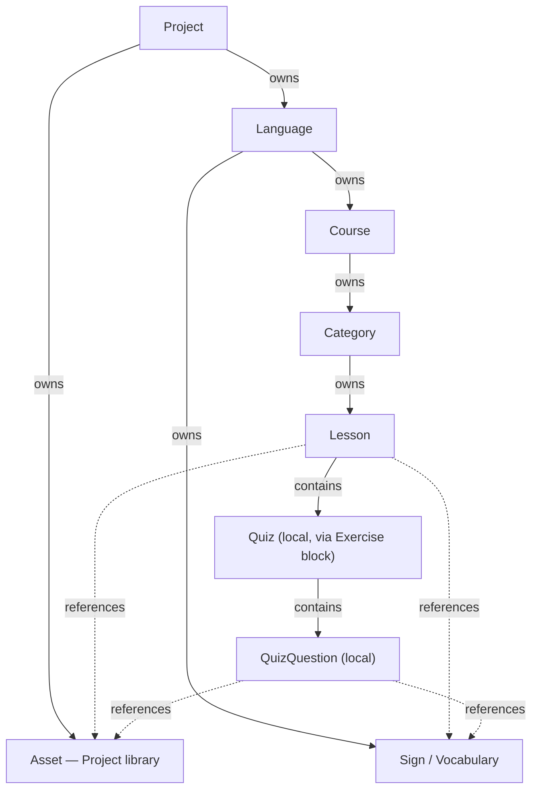

# Sayva Studio — Domain Model

**Status:** Frozen v1.1 · Reference
**Scope:** Business concepts only — entities, value objects, aggregate boundaries, and invariants for authoring Language Packs.
No persistence, UI, or framework structure implied.

All review questions are resolved and recorded as a Decision Log (§9).
This is the reference the Architecture phase builds from.
Amended once (DL-08) during Pack Specification design — see the changelog at the bottom of this file.

## Contents

1. [Ubiquitous Language](#1-ubiquitous-language)
2. [Aggregate & Ownership Map](#2-aggregate--ownership-map)
3. [Entities](#3-entities)
4. [Value Objects](#4-value-objects)
5. [Identity Strategy](#5-identity-strategy)
6. [Versioning Strategy](#6-versioning-strategy)
7. [Domain Invariants](#7-domain-invariants)
8. [Lifecycle](#8-lifecycle)
9. [Decision Log](#9-decision-log)
10. [Future Extensibility](#10-future-extensibility)

---

## 1. Ubiquitous Language

The vocabulary every future document, ticket, and conversation should use consistently.

| Term | Definition |
|---|---|
| **Project** | One authoring workspace — a `.sayva` file. Contains one or more Languages. Never shipped to Mobile. |
| **Language** | A sign language being taught (ASL, BSL, ISL…). The top-level content aggregate; maps 1:1 to a shipped Language Pack. |
| **Course** | A structured curriculum path within a Language, e.g. "ASL for Beginners." |
| **Category** | A thematic grouping of Lessons within a Course, e.g. "Greetings," "Numbers." |
| **Lesson** | One teachable unit: an ordered `LessonContent` — a list of typed blocks — plus its Publish state. |
| **Content Block** | One typed unit of a Lesson: Vocabulary, Media, Tip, or Exercise. Open set — new teaching ideas become new block types, not new Lesson fields. |
| **Sign** | One canonical vocabulary entry in a Language — the atomic thing being taught and tested. Shared reference point for lessons, quizzes, Mobile's Live Camera/Translation, and future ML labels. |
| **Asset** | A reusable media file — Image or Audio — held in the Project's shared library and referenced by ID, never embedded. |
| **Pack** | The immutable, versioned build output of a Language. What Sayva Mobile actually consumes. |

> **Naming trap — Language ≠ Localization.**
> *Language* is the sign language being taught.
> *Localization* is the spoken/written locale (en-US, es-ES…) that authored text is translated into for the Mobile UI.
> A single Language declares which locales its content supports; the two axes are independent.

## 2. Aggregate & Ownership Map

Solid arrows are ownership (composition, cascades on delete).
Dashed arrows are reference-by-ID (validated, never cascades).

**Legend:** solid = owns (cascades) · dashed = references by ID (validated) · Aggregate Roots are independently creatable/loadable/saveable · Local entities have no independent lifecycle.

## 3. Entities

Each aggregate root is independently creatable, loadable, and saveable — it holds its parent by reference, it is not embedded inside it.
This suits a single-user authoring tool better than one giant Language aggregate: editing one Lesson never has to lock the whole curriculum tree.

### Project — Aggregate Root

| Field | Value |
|---|---|
| id | `ProjectId` |
| parent | — (root of the authoring tree) |
| owns | `LanguageId[]`, the Asset Library |
| lifecycle | Created → Active ⇄ Archived → Deleted |
| invariants | Name required, non-empty · SchemaVersion must be readable by the current Studio build |

Purely an authoring-tool container — Mobile never sees a Project, only the Packs built from its Languages.

### Language — Aggregate Root

| Field | Value |
|---|---|
| id | `LanguageId` |
| parent | `ProjectId` |
| owns | `CourseId[]`, the Sign / Vocabulary pool |
| attrs | Code, DisplayName, SupportedLocales[], CoverImage ref |
| lifecycle | Draft → Active ⇄ Archived |
| invariants | Code unique within Project · DisplayName required in base locale |

**Rule:** maps 1:1 to a Language Pack at build time — this is the unit "Build Pack" operates on.

### Course — Aggregate Root

| Field | Value |
|---|---|
| id | `CourseId` |
| parent | `LanguageId` |
| owns | `CategoryId[]` |
| attrs | Title, Description, Difficulty, EstimatedDuration, Visibility, SortIndex |
| lifecycle | Draft → Published ⇄ Hidden → Archived |
| invariants | Title required · SortIndex unique among siblings |

**Rule:** Publish is a gated transition, not a free toggle — it runs the same checks as Build validation.

### Category — Aggregate Root

| Field | Value |
|---|---|
| id | `CategoryId` |
| parent | `CourseId` |
| owns | `LessonId[]` |
| attrs | Title, Description, SortIndex |
| lifecycle | Inherits Course's state — no independent Visibility (DL-04) |
| invariants | Title required · SortIndex unique among siblings |

Purely organizational — a single job: thematic grouping (DL-01).

### Lesson — Aggregate Root

| Field | Value |
|---|---|
| id | `LessonId` |
| parent | `CategoryId` |
| contains | a `LessonContent` — an ordered list of polymorphic `ContentBlock`s (local) |
| attrs | Title, Description, SortIndex, Visibility |
| lifecycle | Draft → Published ⇄ Archived |
| invariants | Title required · Publish needs ≥1 content block and ≥1 ExerciseBlock with ≥1 question · every Asset/Sign reference resolves |

**Rule:** every block is saved atomically with the Lesson and carries local identity for stable reordering (DL-07).
New content ideas become new block types — the Lesson entity itself never grows a field for them.

### Quiz — Local Entity

| Field | Value |
|---|---|
| id | `QuizId` (not independently addressable) |
| parent | an `ExerciseBlock` in the Lesson's content list |
| owns | `QuizQuestion[]` |
| attrs | PassingScore (optional), ShuffleQuestions |
| invariants | ≥1 question required for the parent Lesson to Publish |

The payload of an ExerciseBlock (DL-07) — still inside the Lesson aggregate boundary.
A future Lesson could hold more than one, e.g. a practice quiz plus a final one.

### QuizQuestion — Local Entity

| Field | Value |
|---|---|
| id | `QuestionId` |
| parent | `QuizId` |
| variants | SignRecognition · MultipleChoice · ImageSelection *(future: SentenceRecognition, ConversationExercise)* |
| invariants | Prompt required · MC / ImageSelection need ≥2 options with exactly one correct (DL-05) · SignRecognition needs a target Sign |

Polymorphic by design — new variants must slot in without reshaping existing ones.

### Asset — Aggregate Root

| Field | Value |
|---|---|
| id | `AssetId` |
| parent | `ProjectId` — shared library, DL-03 |
| attrs | Type (Image \| Audio), FileName, MimeType, Checksum, Dimensions/Duration, AltText |
| lifecycle | Uploaded → InUse ⇄ Orphaned → Deleted |
| invariants | Checksum dedupe (soft) · cannot delete while referenced by any Language in the Project |

**Rule:** one Project-wide library, shared across every Language — no duplicate uploads for reused media.
Build Pack filters down to only the Assets the target Language actually references, so each shipped Pack still ships self-contained.

### Sign / Vocabulary — Aggregate Root

| Field | Value |
|---|---|
| id | `SignId` |
| parent | `LanguageId` |
| attrs | Label (stable ML key), DisplayName, ReferenceAsset, Description |
| lifecycle | Draft → Active ⇄ Deprecated (DL-08) |
| invariants | Label unique within Language · cannot delete while referenced |

First-class from the start (DL-02) — the shared reference point for quiz authoring, VocabularyBlocks, Mobile's Live Camera/Translation, and a future ML Studio label space.

### Content Block variants (v1)

`LessonContent` is this open, ordered set of blocks — a new pedagogical idea becomes a new row here, never a new field on Lesson (DL-07).

| Block | Payload | Note |
|---|---|---|
| `VocabularyBlock` | `signs: SignId[]`, note? | The Sign entries taught at this point in the Lesson |
| `MediaBlock` | `asset: AssetReference`, caption? | An Image or Audio asset positioned in the instructional flow |
| `TipBlock` | `text: LocalizedText` | A short supplementary note — formerly a separate Tips list |
| `ExerciseBlock` | `quiz: Quiz` | Wraps the Quiz / QuizQuestion model above |
| …future | — | SentenceRecognition, ConversationExercise — additive, not breaking (§10) |

## 4. Value Objects

No identity of their own — defined entirely by their attributes, always owned by the entity holding them.

| Value object | Shape | Rule |
|---|---|---|
| `LocalizedText` | base locale + map\<locale, string\> | Base-locale entry required; others optional; no empty strings; falls back to base at read time |
| `LocaleCode` | BCP-47 string | e.g. `en-US` |
| `SortIndex` | ordered value | Unique and totally ordered among siblings |
| `Visibility` | enum | Draft · Published · Hidden |
| `Difficulty` | enum | Beginner · Intermediate · Advanced |
| `Duration` | positive integer | Minutes |
| `AssetReference` | assetId + expectedType | Validated against the Asset aggregate, not trusted blindly |
| `Metadata` | createdAt, updatedAt, createdBy?, tags[], notes? | `createdBy` is a reserved no-op in v1 — no auth yet |
| `Version` | see §6 | Entity revision and Pack version are distinct — never conflate them |

## 5. Identity Strategy

Every entity ID is a client-generated UUID, assigned at creation time inside Studio — never server-assigned, because no server exists in v1.
This guarantees uniqueness without coordination, works fully offline, and keeps identity owned by Studio rather than by whatever storage layer sits underneath, so it survives the later move to cloud persistence unchanged.

IDs are permanent once assigned: never reused, never recycled after a delete, so a stale reference is always detectably broken rather than silently pointing at the wrong thing.
Human-readable codes (a Language's short code, for instance) are a separate, editable concern from identity, which never changes.

## 6. Versioning Strategy

Two distinct concerns, not to be conflated:

- **Entity revision** — an internal edit counter or timestamp per entity, for future conflict detection once cloud sync exists, and for undo/history. Not user-facing in v1.
- **Pack version** — assigned when Build Pack runs for a Language (confirmed per-Language, not per-Project — DL-06). This is what Mobile checks to know new content exists. Semantic versioning, with the bump level driven by what actually changed.

| Change | Bump | Note |
|---|---|---|
| Pack schema/structure change breaking Mobile compatibility | `MAJOR` | — |
| New Course or Lesson added | `MINOR` | Backward compatible |
| Existing Lesson content edited or fixed | `PATCH` | No structural change |
| Course or Lesson removed or hidden | `MINOR` | Deferred, not a v1 blocker: still needs a rule for a learner mid-progress on removed content |

## 7. Domain Invariants

Project-wide rules — hold regardless of which entity is being edited.

1. **ID uniqueness** — every entity ID is unique within its Project.
2. **Referential integrity** — every reference (AssetReference, SignId, parent ID) resolves to an existing, non-deleted entity. No dangling references.
3. **Hierarchical ownership** — every Course, Category, and Lesson has exactly one parent. Orphaned entities are invalid.
4. **Ordering integrity** — SortIndex values are unique among siblings.
5. **Publish gate** — an entity transitions to Published only if it and its required children pass validation.
6. **Asset referential safety** — an Asset cannot be deleted while referenced; break the references first.
7. **Localization completeness (soft)** — missing translations for a declared SupportedLocale warn at build time, they don't block it.
8. **Pack self-containment** — Build Pack includes only the Assets the target Language actually references, even though Assets are authored in a shared, Project-wide library (DL-03).

## 8. Lifecycle

State machines, consolidated. Consult §3 for what triggers each transition.

| Entity | States | Note |
|---|---|---|
| Project | Created → Active ⇄ Archived → Deleted | Delete is explicit and destructive |
| Language | Draft → Active ⇄ Archived | — |
| Course / Category / Lesson | Draft → Published ⇄ Hidden → Archived | Publish gated by validation (Inv. 5) |
| Asset | Uploaded → InUse ⇄ Orphaned → Deleted | Orphan status detected by a validation pass |
| Sign | Draft → Active ⇄ Deprecated | Active = complete and enabled for use — no reviewer workflow in v1 (DL-08) |
| Pack | Generated (immutable) | A new Build produces a new Pack — never mutates a prior one |

## 9. Decision Log

Eight resolved decisions, each recorded with its reason, the alternatives considered, and its consequences.
This is the record the rest of the document already reflects.

### DL-01 — Curriculum hierarchy is four levels deep

- **Decision:** Language → Course → Category → Lesson, confirmed as written.
- **Reason:** Course carries Difficulty/Duration/Ordering; Category keeps a single job — thematic grouping — separate from that.
- **Alternatives considered:** flatten Category into Course; make Category a sibling of Course under Language. Both rejected — neither adds authoring value over the 4-level tree.
- **Consequences:** four independent aggregate roots to manage in CRUD/UI; the SortIndex invariant applies at three separate sibling levels.

### DL-02 — Sign / Vocabulary is a first-class aggregate, from the start

- **Decision:** introduce `Sign` as a Language-scoped Aggregate Root now, not deferred.
- **Reason:** single source of truth for a taught sign — shared key across quiz authoring, VocabularyBlocks, Mobile's Live Camera/Translation, and a future ML Studio label space.
- **Alternatives considered:** keep SignRecognition self-contained with a raw label string (rejected — zero integrity checking on the product's most central quiz type); defer the decision (rejected — retrofit cost judged higher than the upfront modeling cost).
- **Consequences:** Sign Management becomes a new authoring feature area — CRUD, an enable/deprecate lifecycle, delete-while-referenced protection — not explicit in the original feature list. (Lifecycle simplified further at DL-08.)

### DL-03 — Asset Library is Project-wide, not per-Language

- **Decision:** `Asset` is a Project-scoped Aggregate Root — one shared library across every Language in the Project. Build Pack filters to only the Assets the target Language actually references.
- **Reason:** avoids re-uploading identical media when it's reused across two sign languages authored in the same Project, while the Pack Builder's reference-filtering step keeps each shipped Pack self-contained regardless.
- **Alternatives considered:** per-Language scope, the original default (rejected — forces duplicate uploads for shared media); dedupe by content hash alone with no shared library concept (rejected — doesn't give authors one browsable library).
- **Consequences:** the future Build System *must* implement reference-scanning per Language — no longer optional; Asset delete-while-referenced checks now scan across every Language in the Project, not just one.

### DL-04 — Category has no independent Visibility

- **Decision:** Category always inherits its parent Course's Draft/Published/Hidden state.
- **Reason:** one fewer state machine, and one fewer way for a Category and its Course to silently disagree.
- **Alternatives considered:** independent Visibility on Category — rejected, no authoring use case justified the added consistency invariant.
- **Consequences:** Category's lifecycle row is "inherited," not a state machine of its own.

### DL-05 — Single-correct answers for v1 question types

- **Decision:** MultipleChoice and ImageSelection require exactly one correct option in v1.
- **Reason:** keeps v1 validation and authoring UI simple; matches the three named v1 quiz types.
- **Alternatives considered:** a boolean-per-option multi-select model now — rejected, adds complexity with no current requirement behind it.
- **Consequences:** a future `MultiSelectQuestion` lands as a new, additive Question variant — not a breaking change, confirming the polymorphic design is doing its job.

### DL-06 — Pack versioning is per-Language

- **Decision:** one Pack version number per Language; Build Pack runs per-Language, not per-Project.
- **Reason:** matches Mobile's consumption model — it checks and updates one Language Pack at a time.
- **Alternatives considered:** one version per Project — rejected, would force version bumps on unrelated languages whenever any one of them changes.
- **Consequences:** the §6 bump table applies at Language granularity; a Project itself has no version, only its Languages do.

### DL-07 — Lesson content becomes a polymorphic block model

- **Decision:** replace Lesson's flat fields (content items, tips, target signs, one fixed Quiz) with a single ordered `LessonContent` — a list of polymorphic `ContentBlock`s (v1: VocabularyBlock, MediaBlock, TipBlock, ExerciseBlock; see §3). ExerciseBlock wraps the existing Quiz/QuizQuestion model rather than Quiz being a fixed Lesson field. Each block carries local identity and a SortIndex.
- **Reason:** new pedagogical content types — and even multiple exercises per lesson — become new block variants without ever touching the Lesson aggregate itself. A single ordered list also lets tips, media, and vocabulary interleave in actual teaching sequence, which fixed separate lists can't express.
- **Alternatives considered:** keep separate typed collections and add a new one per content idea — rejected, that's exactly the "continually expanding Lesson" this decision exists to avoid; a fully untyped/generic block schema — rejected, loses domain-level validation like "an ExerciseBlock needs ≥1 question."
- **Consequences:** the Lesson Publish invariant changes from "≥1 content item + a Quiz" to "≥1 content block and ≥1 ExerciseBlock with ≥1 question" — validation now traverses a typed list. Lesson authoring becomes block-based (closer to a Notion/Gutenberg editing model) rather than a fixed form — a UI-level consequence worth flagging now even though UI design hasn't started.

### DL-08 — Sign lifecycle simplified — no reviewer workflow in v1

- **Decision:** Sign's lifecycle is `Draft → Active ⇄ Deprecated` — mirroring Language's own three-state pattern — not `Draft → Verified → Deprecated` as first proposed. "Verified" is dropped entirely.
- **Reason:** Review Workflow is explicitly out of scope for v1 — no reviewer role or approval pipeline exists anywhere else in the product. "Verified" implied a review actor and process that doesn't exist; "Active" just means the entry is complete and enabled, consistent with how every other entity's Draft→Published gate already works without implying peer review. Surfaced during Pack Specification design (PS-05).
- **Alternatives considered:** keeping "Verified" as a self-serve state the author sets on their own Sign, no separate reviewer — rejected; the label itself promises a review workflow that isn't true today, inviting confusion once a real reviewer role eventually arrives.
- **Consequences:** Sign's state machine now exactly mirrors Language's. The Pack Specification's Publish requirement (PS-05) checks "Sign is Active," a plain existence-and-enabled check — no reviewer concept anywhere in v1.

## 10. Future Extensibility

Not v1 scope. Noted here because retrofitting is the expensive path.

- **LessonContent** — v1 ships four block variants (§3); SentenceRecognition and ConversationExercise land as new block payload types, never as new fields on Lesson (DL-07).
- **Asset** — the type enum is `{Image, Audio}` for v1; Video (sign demonstration clips) is a likely near-term addition — keep the enum open, not closed-by-assumption.
- **Metadata** — `createdBy` is a reserved no-op today (no auth in v1); it exists for future multi-author attribution.
- **Sign** — stays Language-scoped by design, since a sign's meaning is language-specific. Revisit only if a real need for cross-language sign mapping emerges (e.g. an ASL↔BSL equivalence table).

---

**Changelog**

- **v1.1** — DL-08 added (Sign lifecycle simplified) during Pack Specification design, approved.
- **v1.0** — Initial freeze. DL-01 through DL-07 resolved and approved.
