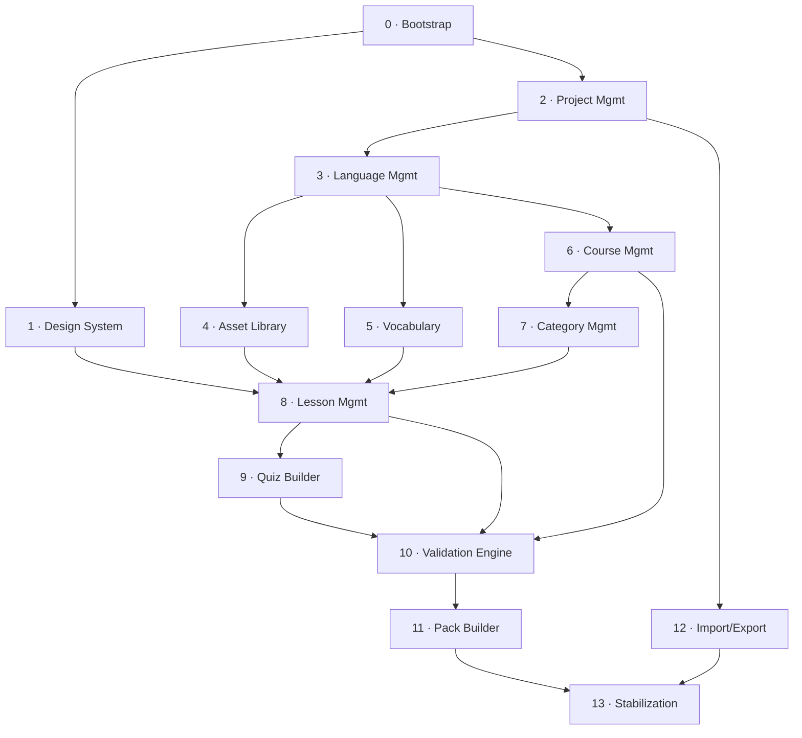

# Sayva Studio — Implementation Roadmap

**Status:** Approved
**Scope:** Fourteen phases, Bootstrap through Stabilization, each with dependencies, acceptance criteria, and a freeze point.
Grounded in the frozen Domain Model, Architecture Blueprint, Pack Specification, and ADR-001/002 — this roadmap invents no new architecture, only sequences what's already decided.

## Contents

- [Sequence Overview](#sequence-overview)
- [Phases](#phases)
- [Cross-Cutting Notes](#cross-cutting-notes)
- [Technical Debt Log](#technical-debt-log)
- [Status](#status)

---

## Sequence Overview

Close to the original sketch, with one deliberate change: **Asset Library and Vocabulary move ahead of Course/Category**, right after Language Management.
Both are pools scoped above the curriculum tree (Asset is Project-scoped per DL-03, Sign is Language-scoped per DL-02) — neither depends on Course or Category existing.
Building them first means Lesson Management and Quiz Builder get real Assets and Signs to reference from day one, instead of building against stubs and redoing that work later.

Two smaller clarifications, not changes: **Quiz Builder is sequenced as a direct successor to Lesson Management**, not a fully independent phase — ExerciseBlock lives inside the same LessonContent model Lesson Management builds (DL-07), so it needs that editor's block infrastructure already in place.
And **Stabilization appears once, at the end**, rather than after every phase — each phase still gets its own freeze point below, but the "Phase X / Stabilization / Cleanup" pattern from the project's Cleanup Policy is applied once, project-wide, before the first release (see [Cross-Cutting Notes](#cross-cutting-notes)).

| # | Phase | Depends on | Scope in one line |
|---|---|---|---|
| 0 | Bootstrap | — | Turborepo, packages, CI, and ADR-002's enforcement stack, live and proven |
| 1 | Design System Foundation | Bootstrap | Tokens and first reusable primitives, each previewable |
| 2 | Project Management | Bootstrap, Design System | Create/open/save/duplicate/delete a Project |
| 3 | Language Management | Project Management | A Project can contain one or more Languages |
| 4 | Asset Library | Project Management | Project-wide media library, upload through delete |
| 5 | Vocabulary | Language Management | Per-Language Sign catalog |
| 6 | Course Management | Language Management | Ordered Courses within a Language |
| 7 | Category Management | Course Management | Ordered Categories within a Course |
| 8 | Lesson Management | Category Mgmt, Asset Library, Vocabulary | Block-based Lesson editor: Tip, Media, Vocabulary blocks |
| 9 | Quiz Builder | Lesson Management | ExerciseBlock: the three v1 question types |
| 10 | Validation Engine | Every content phase above | Domain Services get real teeth; Publish becomes real |
| 11 | Pack Builder | Validation Engine | PackExporter implementation; Build Pack ships a real ZIP |
| 12 | Import/Export | Project Management | Whole-Project portability between Studio installs |
| 13 | Stabilization | Everything | Project-wide audits, regression pass, first release |

## Phases

### Phase 0 — Project Bootstrap

**Depends on:** nothing

**Scope**
- Turborepo workspace; all six ADR-001 packages scaffolded empty
- ADR-002's full stack wired: workspace deps, exports maps, TS project references, ESLint boundaries, dependency-cruiser
- CI running lint + typecheck + test + build on every PR
- Vitest for domain/application; Playwright scaffolded for app e2e

**Acceptance criteria**
- `pnpm build` and `pnpm test` succeed on the empty workspace
- A PR with a deliberately illegal cross-package import (e.g. domain → application) fails CI
- Each package builds independently via `turbo build --filter`

**Freeze point:** CI is green and the illegal-import test fails as designed — proof the enforcement from ADR-002 is live, not just configured. No feature code yet.

### Phase 1 — Design System Foundation

**Depends on:** Bootstrap

**Scope**
- Color, typography, spacing, radius, elevation, motion, icon-size tokens
- First primitives: Button, Card, Dialog, form fields, AppBar, Table shell, Empty/Error/Loading/Success states
- Accessibility baseline set once at the primitive level: focus states, touch targets, contrast

**Acceptance criteria**
- Every primitive has a preview/demo (Preview Requirement)
- Automated accessibility check passes on each preview
- No raw color/spacing/typography values outside the token set

**Freeze point:** The primitive set covers what every CRUD screen in Phases 2–9 needs. Later additions go through "does one already exist?" — not a reopening of this phase.

> **Note:** Zero dependency on `domain` (ADR-002 DR-02) — this can run in parallel with Phase 2 rather than strictly serialized after it.

### Phase 2 — Project Management

**Depends on:** Bootstrap, Design System

**Scope**
- Project aggregate; CreateProject, OpenProject, SaveProject, DuplicateProject, DeleteProject use cases
- Filesystem ProjectRepository
- Project list / create / open screens

**Acceptance criteria**
- Unit tests on Project invariants (Name required, SchemaVersion compatible)
- Integration test: create → save → reopen roundtrip against the real filesystem
- Manual: create / open / duplicate / delete / archive through the UI

**Freeze point:** A Project can be created, opened, saved, duplicated, and deleted end-to-end. Correctly still an empty shell — no Language yet.

> **Note:** Import/Export is listed under Project Management in the original feature brief but is deliberately deferred to Phase 12 — sequenced late for priority, not because it's technically blocked here.

### Phase 3 — Language Management

**Depends on:** Project Management

**Scope**
- Language aggregate; CreateLanguage, UpdateLanguage, ArchiveLanguage, DeleteLanguage
- LanguageRepository
- Language list/create/edit, including SupportedLocales configuration

**Acceptance criteria**
- Unit tests: Code unique within Project, DisplayName required in base locale
- Manual: add a Language, set its locales, archive it

**Freeze point:** A Project holds one or more independently editable Languages. Still no content underneath.

### Phase 4 — Asset Library

**Depends on:** Project Management

**Scope**
- Asset aggregate; UploadAsset, RenameAsset, DeleteAsset, ListOrphanedAssets
- Filesystem AssetRepository; checksum-based dedupe (soft)
- Library screen: upload, browse, search, orphan detection

**Acceptance criteria**
- Unit test: delete blocked while referenced
- Integration: upload → appears in library → delete → removed from disk
- Manual: image and audio upload paths both covered

**Freeze point:** The Project-wide library is fully usable on its own, independent of any Language's content tree.

> **Note:** No dependency on Language Management — Project-scoped per DL-03. Sequenced here specifically so Phases 8–9 have real Assets to reference instead of stubs.

### Phase 5 — Vocabulary

**Depends on:** Language Management

**Scope**
- Sign aggregate; CreateSign, DeprecateSign, DeleteSign (no VerifySign — DL-08's simplified lifecycle)
- SignRepository; ReferenceGuard's delete-while-referenced check
- Per-Language Vocabulary screen: list, create, edit, deprecate

**Acceptance criteria**
- Unit tests: Label unique within Language, delete blocked while referenced
- Manual: add Signs, deprecate one, confirm delete-while-referenced (full check once Phase 8 exists to create a real reference)

**Freeze point:** A Language's Vocabulary is independently manageable — exactly what Phases 8–9 need before they can offer real Sign pickers.

### Phase 6 — Course Management

**Depends on:** Language Management

**Scope**
- Course aggregate; CreateCourse, UpdateCourse, ReorderCourses, PublishCourse
- CourseRepository; Difficulty/Duration/Visibility/Ordering fields

**Acceptance criteria**
- Unit tests: Title required, SortIndex uniqueness via OrderingRules
- Manual: create / reorder / publish / hide a Course

**Freeze point:** Courses exist and are orderable within a Language.

> **Note:** Publish is a state flag only at this point — PublishGate's real validation logic isn't wired in until Phase 10. Don't read this phase's "Publish" as fully meaningful yet.

### Phase 7 — Category Management

**Depends on:** Course Management

**Scope**
- Category aggregate; CreateCategory, UpdateCategory, ReorderCategories, DeleteCategory
- CategoryRepository; UI reflects Course-inherited visibility only — no independent toggle (DL-04)

**Acceptance criteria**
- Unit tests on Category invariants
- Manual: create / reorder / delete Categories within a Course

**Freeze point:** The curriculum tree is navigable three levels deep. Still no Lessons underneath.

### Phase 8 — Lesson Management

**Depends on:** Category Mgmt, Asset Library, Vocabulary

**Scope**
- Lesson aggregate; LessonContent / ContentBlock model — TipBlock, MediaBlock, VocabularyBlock (ExerciseBlock is Phase 9)
- CreateLesson, AddContentBlock, ReorderContentBlocks, RemoveContentBlock
- LessonRepository saving the whole aggregate atomically (DL-07)
- Block-based editor with drag-and-drop reordering; Asset and Sign pickers wired to real Phases 4/5 data

**Acceptance criteria**
- Unit tests on Lesson/ContentBlock invariants
- Integration: a mixed-block Lesson saves and reloads as one atomic write
- Manual: build a Lesson with a Tip, a Media block, and a Vocabulary block referencing real uploaded Assets and Signs; drag-reorder

**Freeze point:** A Lesson can be authored with real instructional content. Missing only its assessment.

### Phase 9 — Quiz Builder

**Depends on:** Lesson Management

**Scope**
- ExerciseBlock, Quiz, QuizQuestion; the three v1 variants — SignRecognition, MultipleChoice, ImageSelection
- DL-05's single-correct-answer rule; quiz authoring nested inside Phase 8's Lesson editor

**Acceptance criteria**
- Unit tests per question type (Prompt required; MC/ImageSelection need ≥2 options, exactly one correct; SignRecognition needs a target Sign)
- Manual: author one quiz of each question type inside a real Lesson

**Freeze point:** A Lesson can carry a complete, gradable assessment. Last content-authoring phase — every editor a Language needs now exists.

### Phase 10 — Validation Engine

**Depends on:** every content phase (4–9)

**Scope**
- ReferentialIntegrityChecker, OrderingRules, PublishGate, ReferenceGuard — implemented for real
- ValidateLanguageForPublish use case; validation results panel (duplicate IDs, broken references, missing assets, missing quiz, invalid metadata)
- Retroactively gives Phase 6/8's provisional Publish real teeth

**Acceptance criteria**
- Unit test per Domain Model §7 invariant, all eight, plus PS-05's Sign-must-be-Active rule
- A deliberately broken Language is blocked with a specific, actionable error per issue
- Manual: trigger and resolve one error of each category

**Freeze point:** Nothing can Publish, and nothing can build a Pack, without passing every invariant already frozen in the Domain Model and Pack Specification. This is where "documentation is the source of truth" becomes enforced, not just written.

### Phase 11 — Pack Builder

**Depends on:** Validation Engine

**Scope**
- `PackExporter` implementation per the frozen Pack Specification — manifest.json, content.json, vocabulary.json, assets/
- `BuildLanguagePackUseCase` (already specified in the Architecture Blueprint's worked example)
- schemaVersion/packVersion assignment; Build Pack UI with validation report display

**Acceptance criteria**
- A built Pack structurally validates against the Pack Specification — manifest fields present, only Published content, only referenced Assets (DL-03 self-containment), all locales present
- Build against an invalid Language fails with Phase 10's report and writes nothing
- Output IDs match Domain UUIDs exactly (PS-03)

**Freeze point:** Pressing Build Pack on a valid Language produces a ZIP conforming to the frozen Pack Specification — the product's core promise from the project brief.

### Phase 12 — Import/Export

**Depends on:** Project Management

**Scope**
- Whole-Project export: archive the `.sayva` file + Assets/ into a portable bundle
- Import: restore a Project from that bundle — distinct from Pack Builder's Mobile-facing, Language-scoped output

**Acceptance criteria**
- Export → import roundtrip on a multi-Language Project preserves every entity, ID, and Asset exactly
- Importing an incompatible SchemaVersion is rejected with a clear message

**Freeze point:** A Project is fully portable between Studio installations.

> **Note:** Technically only depends on Phase 2 — sequenced this late for priority against the authoring/build path, not because anything blocks it earlier.

### Phase 13 — Stabilization

**Depends on:** everything

**Scope**
- The five mandated audits — Architecture, UI consistency, Accessibility, Design system, Documentation — run once, project-wide
- Cross-cutting bug fixes; performance pass on large Projects
- Documentation finalized: Known Limitations, Future Improvements per every feature doc

**Acceptance criteria**
- All five audits pass, or open findings are explicitly triaged and accepted
- Every phase's manual checklist re-run as one continuous session: Project → Language → Course → Category → Lesson with real content and a quiz → validate → build Pack, no workarounds

**Freeze point:** First production-ready release. Per Feature Freeze, every phase is now frozen — only verified production bugs reopen anything from here.

## Cross-Cutting Notes

Each phase above still runs the full ten-step Development Workflow on its own — design discussion through freeze — this roadmap only fixes the *order* and the *freeze criteria*, not a shortcut around any of those steps.

> **Reconciling the Cleanup Policy.**
> The project's Cleanup Policy calls for "Phase X / Phase X Stabilization / Phase X Cleanup" as separate phases.
> Read literally per-feature, that's 14×3 phases — not what's built here.
> Instead: each phase's own freeze point *is* its stabilization (nothing moves on with known-broken acceptance criteria), and Phase 13 is the one project-wide Stabilization + Cleanup pass the policy calls for, run once against the whole product rather than fragmented across every feature.
> If a specific phase turns out to need its own dedicated stabilization sub-phase once real work starts, that's a roadmap amendment to propose then — not assumed here.

## Technical Debt Log

Deliberately accepted tooling debt, recorded so it's revisited on purpose rather than forgotten. Distinct from the Decision Logs in the frozen architecture documents — these are execution-time tooling calls, not architectural decisions.

### TD-01 — TypeScript pinned to 6.0.3, not the 7.x line

**Accepted during:** Phase 0, Slice 9 (`apps/studio` scaffolding).

**What:** the workspace runs TypeScript `^6.0.3` everywhere, not the newer 7.x (native, Go-based) line.

**Why:** two independent, major pieces of tooling didn't yet support TypeScript 7 when this was decided. `next build` failed outright — Next.js's build-time type-checking has no path to TS7's native compiler API without the experimental `useTypeScriptCli` flag. Separately, `typescript-eslint@8.65.0` and its `@typescript-eslint/*` family declare peer support only for TypeScript `<6.1.0`. Building Phase 0's foundation on an experimental Next.js flag was judged worse than pinning to a slightly older, fully-supported compiler version — see the Phase 0 amendment commit for the full comparison.

**Revisit when:** Next.js ships non-experimental support for the TypeScript 7 compiler API, *and* `typescript-eslint` declares support for TypeScript 7 in its peer ranges. Check both before upgrading — either alone re-creates one of the two original problems.

### TD-02 — `test` has an undeclared dependency on `^build` — RESOLVED (Slice 14)

**Accepted during:** Phase 0, Slice 13 (Testing Setup).

**What:** `@sayva/application`'s smoke test loads `src/index.ts`, which imports `@sayva/domain` by its public package name. Vitest resolves that the same way Node does — through `@sayva/domain`'s `package.json` `exports` map, which points at `dist/index.js` (DR-05). If `@sayva/domain` hasn't been built, `pnpm test` inside `@sayva/application` fails with a module-resolution error, not a test failure. Verified directly: removing `packages/domain/dist` and rerunning `application`'s test reproduces exactly this failure; restoring it fixes the test again with no other change.

**Why accepted then:** this is the same build-order requirement `tsc -b`'s project references already have (Slice 8) — nothing new was being introduced, just newly observable because `test` is the first script that resolves the built dist of a *dependency* package rather than only its own. There was no `turbo.json` yet to encode task ordering, so nothing enforced "build dependencies before testing dependents"; running package scripts directly in the wrong order would hit this.

**Resolution:** `turbo.json`'s `test` task declares `"dependsOn": ["^build"]`, exactly as planned. The same real gap turned up a second time during Slice 14 for `check-types` (`tsc --noEmit` also needs a dependency's built `.d.ts` to resolve its types) and got the same fix. Verified live: `turbo run test` and `turbo run check-types` from a fully clean workspace (no dist anywhere) both auto-build every dependency first, with zero manual steps — see the Slice 14 review for the full verification transcript.

**Note (Slice 15):** ADR-002 DR-14 later changed *why* `check-types` needs `^build`. DR-14 pointed `exports["."].types` at TypeScript source instead of `dist`, which fixed resolution for a package with no dependencies of its own — but for a package with a real cross-package dependency (e.g. `application` → `domain`), `tsc --noEmit` still fails on an unbuilt checkout, with a *different* error (`TS6305`): TypeScript's own project-reference consistency check, unrelated to module resolution. `check-types` keeps `dependsOn: ["^build"]` globally rather than special-casing the three dependency-free packages — see DR-14's "Known limitation" note for the full reasoning.

## Status

**Approved.**
Folder Structure, then Turborepo Scaffolding, then Initial Project Bootstrap (Phase 0 above) is the current execution path.
