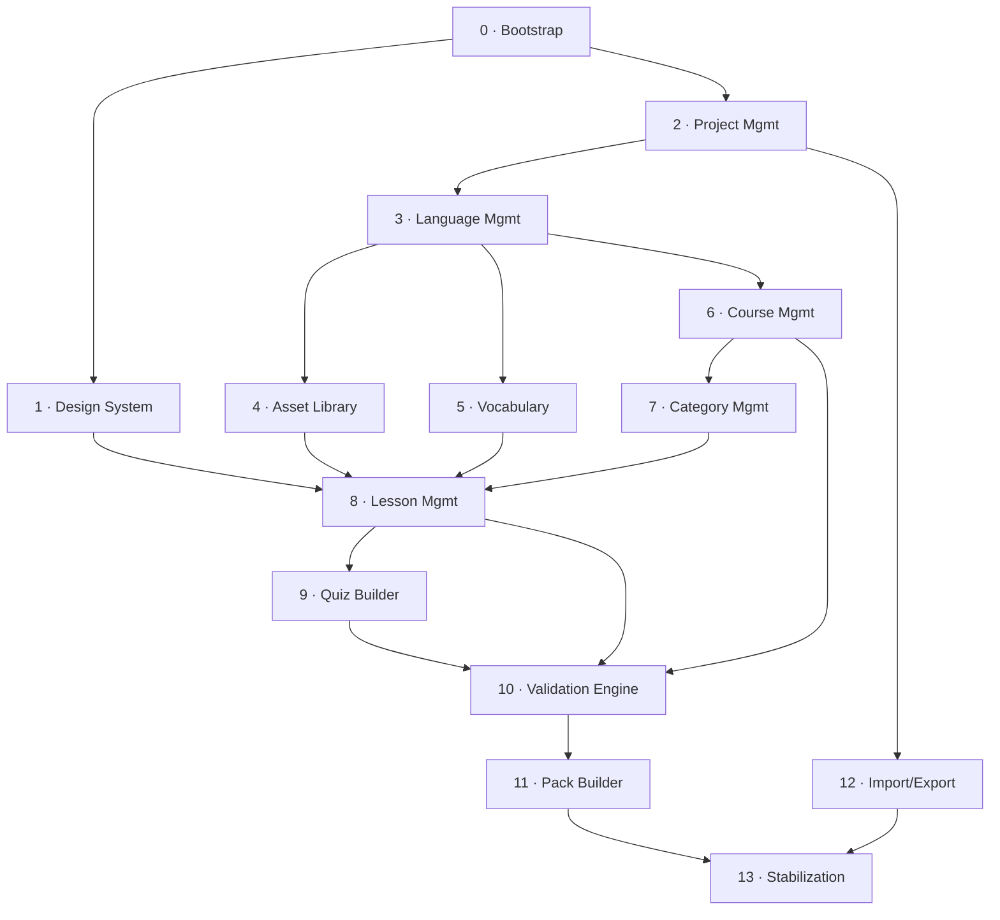

# Sayva Studio — Implementation Roadmap

**Status:** Approved
**Scope:** Fourteen phases, Bootstrap through Stabilization, each with dependencies, acceptance criteria, and a freeze point.
Grounded in the frozen Domain Model, Architecture Blueprint, Pack Specification, and ADR-001/002 — this roadmap invents no new architecture, only sequences what's already decided.

## Contents

- [Sequence Overview](#sequence-overview)
- [Phases](#phases)
- [Cross-Cutting Notes](#cross-cutting-notes)
- [Technical Debt Log](#technical-debt-log)
- [Status](#status)

---

## Sequence Overview

Close to the original sketch, with one deliberate change: **Asset Library and Vocabulary move ahead of Course/Category**, right after Language Management.
Both are pools scoped above the curriculum tree (Asset is Project-scoped per DL-03, Sign is Language-scoped per DL-02) — neither depends on Course or Category existing.
Building them first means Lesson Management and Quiz Builder get real Assets and Signs to reference from day one, instead of building against stubs and redoing that work later.

Two smaller clarifications, not changes: **Quiz Builder is sequenced as a direct successor to Lesson Management**, not a fully independent phase — ExerciseBlock lives inside the same LessonContent model Lesson Management builds (DL-07), so it needs that editor's block infrastructure already in place.
And **Stabilization appears once, at the end**, rather than after every phase — each phase still gets its own freeze point below, but the "Phase X / Stabilization / Cleanup" pattern from the project's Cleanup Policy is applied once, project-wide, before the first release (see [Cross-Cutting Notes](#cross-cutting-notes)).

| # | Phase | Depends on | Scope in one line |
|---|---|---|---|
| 0 | Bootstrap | — | Turborepo, packages, CI, and ADR-002's enforcement stack, live and proven |
| 1 | Design System Foundation | Bootstrap | Tokens and first reusable primitives, each previewable |
| 2 | Project Management | Bootstrap, Design System | Create/open/save/duplicate/delete a Project |
| 3 | Language Management | Project Management | A Project can contain one or more Languages |
| 4 | Asset Library | Project Management | Project-wide media library, upload through delete |
| 5 | Vocabulary | Language Management | Per-Language Sign catalog |
| 6 | Course Management | Language Management | Ordered Courses within a Language |
| 7 | Category Management | Course Management | Ordered Categories within a Course |
| 8 | Lesson Management | Category Mgmt, Asset Library, Vocabulary | Block-based Lesson editor: Tip, Media, Vocabulary blocks |
| 9 | Quiz Builder | Lesson Management | ExerciseBlock: the three v1 question types |
| 10 | Validation Engine | Every content phase above | Domain Services get real teeth; Publish becomes real |
| 11 | Pack Builder | Validation Engine | PackExporter implementation; Build Pack ships a real ZIP |
| 12 | Import/Export | Project Management | Whole-Project portability between Studio installs |
| 13 | Stabilization | Everything | Project-wide audits, regression pass, first release |

## Phases

### Phase 0 — Project Bootstrap

**Depends on:** nothing

**Scope**
- Turborepo workspace; all six ADR-001 packages scaffolded empty
- ADR-002's full stack wired: workspace deps, exports maps, TS project references, ESLint boundaries, dependency-cruiser
- CI running lint + typecheck + test + build on every PR
- Vitest for domain/application; Playwright scaffolded for app e2e

**Acceptance criteria**
- `pnpm build` and `pnpm test` succeed on the empty workspace
- A PR with a deliberately illegal cross-package import (e.g. domain → application) fails CI
- Each package builds independently via `turbo build --filter`

**Freeze point:** CI is green and the illegal-import test fails as designed — proof the enforcement from ADR-002 is live, not just configured. No feature code yet.

**Frozen:** 2026-08-08, at commit `fd6d8ee` (`feat(phase-0): amend DR-05 so lint/depcruise resolve independently of build`). All acceptance criteria met and verified on real GitHub Actions CI, including a live deliberate-failure test (forbidden dependency pushed, confirmed CI-red, reverted, confirmed CI-green) and a final architectural audit (ADR compliance, invariants, technical debt, complexity, Phase 1 readiness) — see the Slice 15 review and audit in project history. One architectural amendment made during the phase: ADR-002 DR-14. Two technical debt items carried forward, both accepted and documented: TD-01 (TypeScript pinned to 6.0.3) and the TS6305/`check-types` build dependency noted under TD-02. No infrastructure decisions from this phase are to be reopened absent a future ADR.

### Phase 1 — Design System Foundation

**Depends on:** Bootstrap

**Scope**
- Color, typography, spacing, radius, elevation, motion, icon-size tokens
- The ten contracted Design System primitives — `SyButton` · `SyField` · `SyStatusBadge` · `SyEntityRef` · `SyMetric` · `SyStateBlock` · `SyMenu` · `SyDrawer` · `SyDialog` · `SyConfidence` — plus the one shared overlay substrate hook
- Accessibility baseline set once at the primitive level: focus states, touch targets, contrast

> **Note on the primitive list.**
> It replaces this phase's original sketch — *"Button, Card, Dialog, form fields, AppBar, Table shell, Empty/Error/Loading/Success states"* — which predates the Sayva Studio design handoff.
> Scope decision **D1** fixed the phase to the design's own ten contracted primitives and deferred its twelve patterns as needing application-layer infrastructure.
> The sketch's names map onto that set where they map at all: Button → `SyButton`, Dialog → `SyDialog`, form fields → `SyField`, Empty/Error/Loading/Success → `SyStateBlock`'s six states. Card has no counterpart in the design; AppBar and Table shell became `SyAppShell` and `SyCollection`, both **deferred** by D1.

**Acceptance criteria**
- Every primitive has a preview/demo (Preview Requirement)
- Automated accessibility check passes on each preview
- No raw color/spacing/typography values outside the token set

**Freeze point:** The primitive set covers what every CRUD screen in Phases 2–9 needs. Later additions go through "does one already exist?" — not a reopening of this phase.

> **Resolved by ruling, 2026-09-01 — the criterion is read within D1's scope.**
> The criterion above asks whether the primitive set covers every CRUD screen in Phases 2–9. D1 scoped this phase to the ten primitives and **deferred all twelve patterns**, including `SyAppShell` (the shell every screen sits in) and `SyCollection` (the list every CRUD screen shows), as needing application-layer infrastructure. Read literally against the whole product the criterion could not be met, and read against D1's scope it is.
> The design owner ruled the second reading: the criterion is satisfied by the ten contracted primitives and the shared overlay substrate, complete and verified. The deferred patterns are **not** pulled back into Phase 1 — each is built in the application phase that requires it, where the infrastructure D1 cited actually exists. D1 is not reopened and no token changed.

> **Note:** Zero dependency on `domain` (ADR-002 DR-02) — this can run in parallel with Phase 2 rather than strictly serialized after it.

### Phase 2 — Project Management

**Depends on:** Bootstrap, Design System

**Scope**
- Project aggregate; CreateProject, OpenProject, SaveProject, DuplicateProject, DeleteProject use cases
- Filesystem ProjectRepository
- Project list / create / open screens

**Acceptance criteria**
- Unit tests on Project invariants (Name required, SchemaVersion compatible)
- Integration test: create → save → reopen roundtrip against the real filesystem
- Manual: create / open / duplicate / delete / archive through the UI

**Freeze point:** A Project can be created, opened, saved, duplicated, and deleted end-to-end. Correctly still an empty shell — no Language yet.

> **Infrastructure prerequisites — resolved by [ADR-003](../adr/ADR-003-storage-mechanism-and-project-persistence.md), 2026-09-11.**
> The Domain and Application layers were unblocked and built first. The filesystem `ProjectRepository` was not: three questions the frozen documents left open had to be answered before an adapter could exist — the **storage mechanism** (deferred by name in Architecture Blueprint §9), the **`.sayva` file format** (named in the Domain Model's glossary, never specified), and the **Project `SchemaVersion` compatibility rule** (the invariant is stated in Domain Model §3; the rule behind it was not, which left this phase's first acceptance criterion only half-enforceable).
> All three are now ruled — direct Node `fs`, one UTF-8 JSON file per Project written atomically, and `schemaVersion <= CURRENT_PROJECT_SCHEMA_VERSION`. No frozen document was changed: ADR-003 supplies what §9 deferred, in the form §9 called for.

> **Acceptance criterion 2 — satisfied, interpretation recorded 2026-09-14.**
> "create → save → reopen" is read as the **operations**, not the use cases, and the criterion is met by the real-filesystem repository integration test in `@sayva/infrastructure` (commit `72ae0c7`), which performs create → save → reopen → edit → save → reopen against a per-test temporary directory.
> Three things settle the reading. There is no `ReopenProject` use case — the five are Create, Open, Save, Duplicate and Delete — so "reopen" describes writing something and reading it back again rather than naming an operation. Criterion 3 uses the use-case vocabulary explicitly and separately ("create / open / duplicate / delete / archive **through the UI**"), which is the layer criterion; this one's distinguishing qualifier is "against the real filesystem", which is the storage. And the strict reading has no legal home: ADR-002 DR-02 lets only `app` depend on both `application` and `infrastructure`, `apps/studio` runs Playwright rather than Vitest, and its config states "First real spec lands with the first real page".
> Residual risk, stated rather than hidden: nothing yet composes the real adapter with the use cases. That gap is one object literal — the use cases run end to end against a fake that honours the port, the adapter is verified against that same port, and the port's types are compile-checked. The composition becomes testable without new tooling once a Composition Root exists. No architecture, tooling or test-runner change was made.

> **Third scope bullet — governed by [ADR-004](../adr/ADR-004-project-management-is-pre-shell.md), 2026-09-14.**
> "Project list / create / open screens" could not start because the design does not model Project at all — zero occurrences in the design inventory, and every one of the URL contract's eleven routes presupposes an open workspace. Ruled: **Project management sits before `SyAppShell`**, as a pre-shell workspace picker. It therefore requires neither `SyAppShell` nor `SyScopeBar`, and `SyCollection` is not forced into it — which leaves D4, D6 and the Domain repository port untouched.
> The surface has no canonical design, so one is commissioned in [the Project picker design commission](./phase-2-project-picker-design-commission.md). Implementation stays blocked until that design exists.

> **Project Picker readiness rulings — PP-01 to PP-04, approved 2026-09-22.**
> A readiness audit found the picker's design complete but the codebase unable to host it. Four decisions were taken, none of which resolves any previously blocked item.
> - **PP-01 — stylesheet consumption.** `@sayva/design-system` gains a public `./styles` export and `apps/studio` owns the Tailwind/PostCSS pipeline. Recorded as [ADR-002](../adr/ADR-002-dependency-rules.md) **DR-16**, including the deliberate DR-14 exception: CSS is source-consumed and has no compiled `dist` artifact.
> - **PP-02 — workspace root.** Supplied by `SAYVA_WORKSPACE_ROOT`, read only in the Composition Root, no default, and exposed to the picker as serializable presentation data because the design requires the UI to name the location it is listing. Recorded as [ADR-003](../adr/ADR-003-storage-mechanism-and-project-persistence.md) **SR-09**. The directory itself stays a deployment decision.
> - **PP-03 — app UI testing.** Phase 0's topology — "Vitest for domain/application; Playwright scaffolded for app e2e" — is **extended**: `apps/studio` gains Vitest + React Testing Library + jsdom + `vitest-axe`, mirroring the stack already proven across design-system's 639 tests. Playwright keeps the e2e role Phase 0 gave it. This is an extension, not a replacement, and introduces no new testing architecture — the app spreads the same `@sayva/vitest-config/react` config design-system does.
>   **Implemented 2026-09-22.** Two deviations from design-system were forced by the app being a Next app rather than a library, and both are recorded in `apps/studio/vitest.config.mts`: the config is `.mts` because the app has no `"type": "module"`, and the JSX transform is requested through `oxc` because `nextjs.json` sets `jsx: "preserve"` for Next to handle, which leaves the test runner's parser with raw JSX.
>   **Type-checking decision.** The app needs **no separate check-types project** — `nextjs.json` already sets `noEmit`, so there is no dist to keep tests out of and nothing to split. Its `include` therefore picked test files up for free, which surfaced the gap design-system's `tsconfig.check.json` already records: checking them requires typing the `@sayva/vitest-config/axe` helper and registering its `toHaveNoViolations` matcher, both in another package. App test files are excluded for now, for the same recorded reason and not by oversight. **Fixing it once in `@sayva/vitest-config` would let both exclusions go** — worth its own change rather than a side effect of an app slice.
> - **PP-04 — Project list sorting.** `updatedAt` descending is assembled in `listProjectsUseCase`, not in a component. The canonical design's "client-side — no port change" is read as *outside the repository and outside a server-side data query* — its own trailing qualifier, and the contrast the design draws with rule **R17 Server-side aggregation**. The decision-worthy ordering then sits where AD-07 puts it: inside a Query use case's View Model assembly, never inline in a Server Component. `ProjectRepository.findAll()` is unchanged and gains no sort, filter or page parameter. The canonical wording in Screens §04 is **not** altered — only its reading is recorded, so no re-authoring or re-export is required.

> **Project Picker readiness rulings — RB-1 to RB-6, 2026-09-24.**
> A readiness pass for the Picker's first, read-only slice found every visible part of it needing a value or decision the canonical design had not made. Rulings, recorded before any Picker code is written:
> - **RB-1 — how a file failure reaches the screen.** Approved in principle as [ADR-003](../adr/ADR-003-storage-mechanism-and-project-persistence.md) **SR-10**: a Domain-side failure contract carries the affected location; Application maps it to a serializable View Model state; `ProjectFileError` stays an Infrastructure detail. Exact shape deferred to the implementing slice.
>   **Implemented 2026-09-28** with the Picker's read-only slice, as the Domain class `ProjectFileFailure`; the shape is recorded in SR-10.
> - **RB-2 — the error state's trace ID. Resolved 2026-09-24 as [ADR-003](../adr/ADR-003-storage-mechanism-and-project-persistence.md) SR-11.** `SyStateBlock` requires one (AC14) and prints it after a visible **Trace ID** label, so a stable diagnostic code was rejected: it would name a category as if it were an occurrence. Instead each list-read failure gets a real per-occurrence ID, written with the failure's details to the server's existing diagnostic output so the on-screen value leads to a record. Not the file path, not Next.js's `digest`, not persisted, and used only for the Picker's read failure. A minimal mechanism — one Domain port, one Infrastructure adapter — not a logging system.
> - **RB-3 — `updatedAt`.** Compact relative time, following the drawn Vocabulary grid's `Updated` column; the machine value in `<time datetime>`. Two stated extensions beyond that precedent: a minute unit, and weeks with no larger unit.
> - **RB-4 — the header's workspace-root line** reads "Studio is looking in {root}", reusing the first-run line's sentence rather than adding copy. The PP-02 proof's "Workspace root:" label is not canonical and is not reused.
> - **RB-5 — loading's accessible name** is the same sentence. Still a skeleton, not a spinner.
> - **RB-6 — first-run renders without `New Project`** as a recorded temporary slice boundary; the action arrives with the Create slice. The header's `New Project` is the same action and is deferred with it. No substitute and no disabled button, and first-run is never a bare empty list.
>
> All of RB-2 to RB-6 are authored into the Claude Design project as amendments to Screens §04 and re-exported. With RB-2 resolved, nothing in the canonical design blocks the Picker's read-only slice.
>
> **§04 copy transcription, 2026-09-28.** §04 cited "the four copy strings" without stating them. The three that belong to §6 of the design, as approved at `8d0deb6`, are now transcribed into §04 verbatim and re-exported: first-run's heading "No projects yet" and line "Studio is looking in {root}. A project is one .sayva file.", and error's heading "Can't read the projects folder". Words only, with no formatting implied. The fourth string, §4's newer-schema reason, belongs to Open and is deliberately not transcribed.

> **Project Picker decision closure, 2026-09-28.** Two cases the read-only slice surfaced, which no canonical source decided:
> - **A future `updatedAt`.** An `updatedAt` later than the moment the page renders counts as zero elapsed time, so it reads `0m ago`. This is the only extension to RB-3. It adds no copy, threshold, format or absolute date. Authored into Screens §04 §5 and the inventory, and re-exported. The implementation already behaves this way, so no code changed.
> - **Focus after a successful Retry — Option A.** Follow the contract as written: focus moves only by `SyStateBlock`'s rule, and this slice introduces no other focus behaviour. The read-only Picker has no focusable target after a successful recovery into the list or first-run, and the canonical sources do not define programmatic focus for those states. Recovery-to-list announcement and focus can be reconsidered in the Open slice, when a real focusable Open target exists. Recorded here only: the canonical design has no decision or open-items record for it, so §04 is unchanged for this ruling.

> **Create Project decision closure, 2026-09-29.** A readiness inspection found the Create slice blocked. Each item below is ruled by the owner, and the design items are authored into Screens §04, then re-exported and read back. Create is **not implemented yet**; this records what its slice will build.
> - **B1 — success (temporary slice boundary, like RB-6).** Create stays in the picker for now: on success the drawer closes, the picker re-scans, and the new Project appears by `updatedAt` descending. §04's "Creation opens the new Project immediately" arrives with the Open slice. No Open, `SyAppShell`, zero-Language state or hand-off is built.
> - **B2 — a failed write.** `SyStateBlock`'s frozen `error` state, `panel` size, in the drawer body below the name field.
>   - Heading "Can't create the project"; the line names the location.
>   - The drawer stays open and keeps the name; `Retry` re-runs Create with the name currently in the field and takes focus.
>   - Each failed write is a new trace occurrence, which is ADR-003 SR-11's Create extension.
>   - Never shown on the field.
> - **B3 — title** "New Project". **B4 — `Cancel`**, a secondary `SyButton` among the footer actions, as the visible control for `Esc`. **B7 — copy** "Project name", "Give the project a name.", "Create Project", transcribed verbatim from the design approved at `8d0deb6`.
> - **B5 — never dirty.** `Esc` and `Cancel` close the drawer directly, with no discard prompt; `SyDialog` stays unused on this surface. This amends the planning design's original "dirty protects a half-typed name".
> - **B6 — below 900px.** The header's `New Project` is visible and disabled, with the reason "Creating a project needs a window at least 900px wide." First-run renders no action and nothing stands in for it; `SyStateBlock` is not given a disabled form.
> - **B8 — `N` deferred** to a later slice, with its behaviour in editable fields and its hint. D13 is not resolved.
> - **B9 — contract.** `createProjectUseCase(deps, { name })` supplies `CURRENT_PROJECT_SCHEMA_VERSION` itself; the caller cannot pass `schemaVersion` or tags.
> - **B10 — contract.** It returns a serializable result: `{ status: 'created'; project: ProjectView }`, `{ status: 'invalid-name' }` or `{ status: 'write-failed'; traceId; location }`. Only the Domain's name rule maps to `invalid-name`, and only `ProjectFileFailure` maps to `write-failed`; anything else is a defect and is rethrown. No Domain entity or Infrastructure error reaches the UI.
> - **B11 — contract.** A failure to create the workspace root is a `ProjectFileError` located at the root, per ADR-003 SR-10's Create extension.
> - **B12 — form technology.** A controlled `SyField` with Domain validation and no new dependency. The Server Action checks only that the name is a string, and the Domain decides whether it is valid. React Hook Form + Zod remains a separate ruling.
> - **B13 — validation and tones.** The invalid message appears when a submission (`Create Project` or `⌘Enter`) is refused for its name, and stays until the next result; nothing is validated while typing. `Create Project` is the drawer's one primary action, since P2 counts per surface.
> - **B14 — focus after success.** A07 as implemented: focus returns to the trigger while it exists. From first-run, whose trigger the list replaces, no other target is introduced until the Open slice.
> - **B15 — the header's `New Project`** is present in every state (list, first-run, loading, error): the literal appBar.

> **Open decision closure, 2026-10-03 — OD-1 to OD-8.** A readiness analysis found Open blocked three ways: opening had nowhere to land, two confirmed product requirements had no record, and Screens §04 §11 forbade the only carrier that is both per tab and refresh-safe. Each item below is ruled by the owner and recorded in [ADR-005](../adr/ADR-005-opening-a-project-the-workspace-url.md), [ADR-004](../adr/ADR-004-project-management-is-pre-shell.md) **WS-05** and [ADR-003](../adr/ADR-003-storage-mechanism-and-project-persistence.md) **SR-11**. The design items are authored into Screens §04, then re-exported and read back. **Open is not implemented, and this closure does not authorize its implementation.**
> - **Context — PR-OPEN-01 and PR-OPEN-02**, product requirements confirmed by the owner on 2026-10-01. Each browser tab must be able to work with a different Project independently, and a refreshed tab must keep the Project it had open. On a refresh the only per-tab state a server sees is the URL, which is why OD-1 exists.
> - **Identifiers.** The conversation's `DR-O…` and `DR-C…` identifiers are retired for `OD-…`, because "DR-O2" and "DR-C1" read almost exactly like ADR-002's DR-02 and DR-01. `OP-…` are ADR-005's rules.
> - **OD-1 (ruled as DR-C1, 2026-10-01; the shape on 2026-10-03) — the workspace URL.** An opened Project is reached at `/workspace/{projectId}`, a temporary pre-shell workspace URL and the one narrow exception to §04 §11. It is resolved on every request through the existing `openProjectUseCase`. It sits outside the URL contract, which keeps its eleven routes, and it is **not** route twelve: discrepancy #4 and the handoff's "12 routes" are untouched. Blueprint §6 and AD-07 are unchanged.
> - **OD-2 (DR-O3) — zero Languages are valid.** Read from Domain Model §3 and §7, whose invariants require no Language. The frozen Domain Model is not edited.
> - **OD-3 (DR-O1) — a temporary pre-shell Workspace Entry**, not `SyAppShell`. It shows the opened Project's name and supports the zero-Language state. It has no `SyScopeBar`, rail icons, pane persistence, `SyCollection`, Language creation or listing, shell routes or lifecycle display, and **no Back to Projects or other return control**: returning is by navigating to `/`. It is replaced by the shell. Its design is commissioned in [the Workspace Entry design commission](./phase-2-workspace-entry-design-commission.md).
> - **OD-4 (DR-C2) — following a URL is not reopening.** A workspace URL always opens the Project it identifies, from a refresh, history, a bookmark, a copied URL or a restored tab. `/` always shows the Picker, and no last-opened Project is remembered.
> - **OD-5 (DR-C3) — a URL identifies and grants nothing.** A copied workspace URL opens the Project wherever the matching file exists. It grants no access, is not an authentication credential, and is not portable between installations; that is Phase 12's Import/Export.
> - **OD-6 (DR-C6) — two temporary failure categories.** *Not here*: a malformed ProjectId, no matching file, a missing workspace folder, or a changed folder setting. *Can't read*: corrupt JSON, invalid content, an id/file-name mismatch, a permission failure, and — temporarily — a newer schema version. §04 §4's newer-schema treatment stays the target.
> - **OD-7 (DR-O4) — Tab only, for now.** Tab reaches each row's `Open` in visual order, and `Enter` or `Space` activates it. No roving focus. `↑` `↓` and `J` `K` are deferred to a later slice. `Esc`, `⌘Enter` and `N`'s boundary (B8) are unchanged. Until row movement arrives, the three-keys claim does not hold for open.
> - **OD-8 (DR-O5) — validate, then navigate.** `Open` reads the Project first, showing `SyButton`'s contracted `loading` state, and navigates only on success. Can't read replaces the row with `SyStateBlock`'s inline-row `error`, and `Retry` re-scans.
> - **Copy and traces.** Can't read's heading is "Can't open the project", with the location and a trace ID per occurrence. Not here is announced as "Can't find that project" in a screen-local assertive live region, once per occurrence, and never traced. ADR-003 SR-11 now traces three failure categories: the Project-list read, the Create write and the Open read. Its guarantees are unchanged.
> - **The `findAll` limitation stays.** One unreadable file still fails the whole list, so the inline-row error appears only when a file becomes unreadable after the scan. If the file is still unreadable, `Retry`'s re-scan shows "Can't read the projects folder" with a new trace ID; a repaired file's row returns; a removed file's row is gone.
> - **Sequencing.** Before Open can be built:
>   - the not-found announcement's transport is ruled;
>   - the Workspace Entry design is commissioned, approved, authored into Claude Design, and exported and read back;
>   - implementation is separately authorized.
>
>   B1's temporary boundary — a successful create stays in the picker — lifts with the Open slice, as B1 records.
> - **Still open after this closure:**
>   - how "Can't find that project" reaches the picker after a workspace URL returns to `/`;
>   - the Workspace Entry's design;
>   - concurrent editing of one Project in two tabs;
>   - tolerant repository reads;
>   - a distinct newer-schema contract;
>   - a missing folder versus a missing Project, and a permission failure versus corruption;
>   - the shell's URLs;
>   - the exact shape of Open's serializable result;
>   - how the Picker's validation reaches `openProjectUseCase`, within Blueprint §6 and AD-07;
>   - whether a row's `Open` needs an accessible name beyond its label;
>   - discrepancy #4.

> **Still open in this phase:**
> - `ArchiveProject` appears in neither Architecture Blueprint §4's use-case table nor this phase's scope above, while this phase's manual checklist names archive. Unresolved, and deliberately not invented — see ADR-003's "Explicitly not decided here".
> - **Delete semantics are contradicted across canonical sources.** Domain Model §8 states "Delete is explicit and destructive"; the design's rule **R20** states "Soft delete by default. Impact preview computed server-side from the graph and shown before confirmation." Both are canonical. The implementation follows the Domain Model. Recorded as unresolved: `DeleteProject`, `ArchiveProject` and R20 are all unchanged, and archive is **not** assumed to be the soft delete.
> - `Created → Active` has no trigger in any canonical source — §8 defers to §3, and §3 names none.

> **Note:** Import/Export is listed under Project Management in the original feature brief but is deliberately deferred to Phase 12 — sequenced late for priority, not because it's technically blocked here.

### Phase 3 — Language Management

**Depends on:** Project Management

**Scope**
- Language aggregate; CreateLanguage, UpdateLanguage, ArchiveLanguage, DeleteLanguage
- LanguageRepository
- Language list/create/edit, including SupportedLocales configuration

**Acceptance criteria**
- Unit tests: Code unique within Project, DisplayName required in base locale
- Manual: add a Language, set its locales, archive it

**Freeze point:** A Project holds one or more independently editable Languages. Still no content underneath.

### Phase 4 — Asset Library

**Depends on:** Project Management

**Scope**
- Asset aggregate; UploadAsset, RenameAsset, DeleteAsset, ListOrphanedAssets
- Filesystem AssetRepository; checksum-based dedupe (soft)
- Library screen: upload, browse, search, orphan detection

**Acceptance criteria**
- Unit test: delete blocked while referenced
- Integration: upload → appears in library → delete → removed from disk
- Manual: image and audio upload paths both covered

**Freeze point:** The Project-wide library is fully usable on its own, independent of any Language's content tree.

> **Note:** No dependency on Language Management — Project-scoped per DL-03. Sequenced here specifically so Phases 8–9 have real Assets to reference instead of stubs.

### Phase 5 — Vocabulary

**Depends on:** Language Management

**Scope**
- Sign aggregate; CreateSign, DeprecateSign, DeleteSign (no VerifySign — DL-08's simplified lifecycle)
- SignRepository; ReferenceGuard's delete-while-referenced check
- Per-Language Vocabulary screen: list, create, edit, deprecate

**Acceptance criteria**
- Unit tests: Label unique within Language, delete blocked while referenced
- Manual: add Signs, deprecate one, confirm delete-while-referenced (full check once Phase 8 exists to create a real reference)

**Freeze point:** A Language's Vocabulary is independently manageable — exactly what Phases 8–9 need before they can offer real Sign pickers.

### Phase 6 — Course Management

**Depends on:** Language Management

**Scope**
- Course aggregate; CreateCourse, UpdateCourse, ReorderCourses, PublishCourse
- CourseRepository; Difficulty/Duration/Visibility/Ordering fields

**Acceptance criteria**
- Unit tests: Title required, SortIndex uniqueness via OrderingRules
- Manual: create / reorder / publish / hide a Course

**Freeze point:** Courses exist and are orderable within a Language.

> **Note:** Publish is a state flag only at this point — PublishGate's real validation logic isn't wired in until Phase 10. Don't read this phase's "Publish" as fully meaningful yet.

### Phase 7 — Category Management

**Depends on:** Course Management

**Scope**
- Category aggregate; CreateCategory, UpdateCategory, ReorderCategories, DeleteCategory
- CategoryRepository; UI reflects Course-inherited visibility only — no independent toggle (DL-04)

**Acceptance criteria**
- Unit tests on Category invariants
- Manual: create / reorder / delete Categories within a Course

**Freeze point:** The curriculum tree is navigable three levels deep. Still no Lessons underneath.

### Phase 8 — Lesson Management

**Depends on:** Category Mgmt, Asset Library, Vocabulary

**Scope**
- Lesson aggregate; LessonContent / ContentBlock model — TipBlock, MediaBlock, VocabularyBlock (ExerciseBlock is Phase 9)
- CreateLesson, AddContentBlock, ReorderContentBlocks, RemoveContentBlock
- LessonRepository saving the whole aggregate atomically (DL-07)
- Block-based editor with drag-and-drop reordering; Asset and Sign pickers wired to real Phases 4/5 data

**Acceptance criteria**
- Unit tests on Lesson/ContentBlock invariants
- Integration: a mixed-block Lesson saves and reloads as one atomic write
- Manual: build a Lesson with a Tip, a Media block, and a Vocabulary block referencing real uploaded Assets and Signs; drag-reorder

**Freeze point:** A Lesson can be authored with real instructional content. Missing only its assessment.

### Phase 9 — Quiz Builder

**Depends on:** Lesson Management

**Scope**
- ExerciseBlock, Quiz, QuizQuestion; the three v1 variants — SignRecognition, MultipleChoice, ImageSelection
- DL-05's single-correct-answer rule; quiz authoring nested inside Phase 8's Lesson editor

**Acceptance criteria**
- Unit tests per question type (Prompt required; MC/ImageSelection need ≥2 options, exactly one correct; SignRecognition needs a target Sign)
- Manual: author one quiz of each question type inside a real Lesson

**Freeze point:** A Lesson can carry a complete, gradable assessment. Last content-authoring phase — every editor a Language needs now exists.

### Phase 10 — Validation Engine

**Depends on:** every content phase (4–9)

**Scope**
- ReferentialIntegrityChecker, OrderingRules, PublishGate, ReferenceGuard — implemented for real
- ValidateLanguageForPublish use case; validation results panel (duplicate IDs, broken references, missing assets, missing quiz, invalid metadata)
- Retroactively gives Phase 6/8's provisional Publish real teeth

**Acceptance criteria**
- Unit test per Domain Model §7 invariant, all eight, plus PS-05's Sign-must-be-Active rule
- A deliberately broken Language is blocked with a specific, actionable error per issue
- Manual: trigger and resolve one error of each category

**Freeze point:** Nothing can Publish, and nothing can build a Pack, without passing every invariant already frozen in the Domain Model and Pack Specification. This is where "documentation is the source of truth" becomes enforced, not just written.

### Phase 11 — Pack Builder

**Depends on:** Validation Engine

**Scope**
- `PackExporter` implementation per the frozen Pack Specification — manifest.json, content.json, vocabulary.json, assets/
- `BuildLanguagePackUseCase` (already specified in the Architecture Blueprint's worked example)
- schemaVersion/packVersion assignment; Build Pack UI with validation report display

**Acceptance criteria**
- A built Pack structurally validates against the Pack Specification — manifest fields present, only Published content, only referenced Assets (DL-03 self-containment), all locales present
- Build against an invalid Language fails with Phase 10's report and writes nothing
- Output IDs match Domain UUIDs exactly (PS-03)

**Freeze point:** Pressing Build Pack on a valid Language produces a ZIP conforming to the frozen Pack Specification — the product's core promise from the project brief.

### Phase 12 — Import/Export

**Depends on:** Project Management

**Scope**
- Whole-Project export: archive the `.sayva` file + Assets/ into a portable bundle
- Import: restore a Project from that bundle — distinct from Pack Builder's Mobile-facing, Language-scoped output

**Acceptance criteria**
- Export → import roundtrip on a multi-Language Project preserves every entity, ID, and Asset exactly
- Importing an incompatible SchemaVersion is rejected with a clear message

**Freeze point:** A Project is fully portable between Studio installations.

> **Note:** Technically only depends on Phase 2 — sequenced this late for priority against the authoring/build path, not because anything blocks it earlier.

### Phase 13 — Stabilization

**Depends on:** everything

**Scope**
- The five mandated audits — Architecture, UI consistency, Accessibility, Design system, Documentation — run once, project-wide
- Cross-cutting bug fixes; performance pass on large Projects
- Documentation finalized: Known Limitations, Future Improvements per every feature doc

**Acceptance criteria**
- All five audits pass, or open findings are explicitly triaged and accepted
- Every phase's manual checklist re-run as one continuous session: Project → Language → Course → Category → Lesson with real content and a quiz → validate → build Pack, no workarounds

**Freeze point:** First production-ready release. Per Feature Freeze, every phase is now frozen — only verified production bugs reopen anything from here.

## Cross-Cutting Notes

Each phase above still runs the full ten-step Development Workflow on its own — design discussion through freeze — this roadmap only fixes the *order* and the *freeze criteria*, not a shortcut around any of those steps.

> **Reconciling the Cleanup Policy.**
> The project's Cleanup Policy calls for "Phase X / Phase X Stabilization / Phase X Cleanup" as separate phases.
> Read literally per-feature, that's 14×3 phases — not what's built here.
> Instead: each phase's own freeze point *is* its stabilization (nothing moves on with known-broken acceptance criteria), and Phase 13 is the one project-wide Stabilization + Cleanup pass the policy calls for, run once against the whole product rather than fragmented across every feature.
> If a specific phase turns out to need its own dedicated stabilization sub-phase once real work starts, that's a roadmap amendment to propose then — not assumed here.

## Technical Debt Log

Deliberately accepted tooling debt, recorded so it's revisited on purpose rather than forgotten. Distinct from the Decision Logs in the frozen architecture documents — these are execution-time tooling calls, not architectural decisions.

### TD-01 — TypeScript pinned to 6.0.3, not the 7.x line

**Accepted during:** Phase 0, Slice 9 (`apps/studio` scaffolding).

**What:** the workspace runs TypeScript `^6.0.3` everywhere, not the newer 7.x (native, Go-based) line.

**Why:** two independent, major pieces of tooling didn't yet support TypeScript 7 when this was decided. `next build` failed outright — Next.js's build-time type-checking has no path to TS7's native compiler API without the experimental `useTypeScriptCli` flag. Separately, `typescript-eslint@8.65.0` and its `@typescript-eslint/*` family declare peer support only for TypeScript `<6.1.0`. Building Phase 0's foundation on an experimental Next.js flag was judged worse than pinning to a slightly older, fully-supported compiler version — see the Phase 0 amendment commit for the full comparison.

**Revisit when:** Next.js ships non-experimental support for the TypeScript 7 compiler API, *and* `typescript-eslint` declares support for TypeScript 7 in its peer ranges. Check both before upgrading — either alone re-creates one of the two original problems.

### TD-02 — `test` has an undeclared dependency on `^build` — RESOLVED (Slice 14)

**Accepted during:** Phase 0, Slice 13 (Testing Setup).

**What:** `@sayva/application`'s smoke test loads `src/index.ts`, which imports `@sayva/domain` by its public package name. Vitest resolves that the same way Node does — through `@sayva/domain`'s `package.json` `exports` map, which points at `dist/index.js` (DR-05). If `@sayva/domain` hasn't been built, `pnpm test` inside `@sayva/application` fails with a module-resolution error, not a test failure. Verified directly: removing `packages/domain/dist` and rerunning `application`'s test reproduces exactly this failure; restoring it fixes the test again with no other change.

**Why accepted then:** this is the same build-order requirement `tsc -b`'s project references already have (Slice 8) — nothing new was being introduced, just newly observable because `test` is the first script that resolves the built dist of a *dependency* package rather than only its own. There was no `turbo.json` yet to encode task ordering, so nothing enforced "build dependencies before testing dependents"; running package scripts directly in the wrong order would hit this.

**Resolution:** `turbo.json`'s `test` task declares `"dependsOn": ["^build"]`, exactly as planned. The same real gap turned up a second time during Slice 14 for `check-types` (`tsc --noEmit` also needs a dependency's built `.d.ts` to resolve its types) and got the same fix. Verified live: `turbo run test` and `turbo run check-types` from a fully clean workspace (no dist anywhere) both auto-build every dependency first, with zero manual steps — see the Slice 14 review for the full verification transcript.

**Note (Slice 15):** ADR-002 DR-14 later changed *why* `check-types` needs `^build`. DR-14 pointed `exports["."].types` at TypeScript source instead of `dist`, which fixed resolution for a package with no dependencies of its own — but for a package with a real cross-package dependency (e.g. `application` → `domain`), `tsc --noEmit` still fails on an unbuilt checkout, with a *different* error (`TS6305`): TypeScript's own project-reference consistency check, unrelated to module resolution. `check-types` keeps `dependsOn: ["^build"]` globally rather than special-casing the three dependency-free packages — see DR-14's "Known limitation" note for the full reasoning.

## Status

**Approved.**
Folder Structure, then Turborepo Scaffolding, then Initial Project Bootstrap (Phase 0 above) were the execution path to get here.

**Phase 0 — Frozen/Complete as of 2026-08-08** (commit `fd6d8ee`). See Phase 0's own entry above for the full freeze record.

**Phase 1 — Frozen/Complete as of 2026-09-01** (commit `1375ded`; implementation complete at `4e9cc93`). Frozen on explicit approval from the design owner, per Definition of Done §9 — the freeze criterion read within scope decision D1, as recorded in the ruling note under Phase 1 above.

All ten contracted primitives are implemented and exported, together with the shared overlay substrate hook. Verified at that commit: 639 tests across 22 files; 33 negative regression cases, each observed failing for its intended reason; `format:check`, `lint`, `dependency-cruiser` (134 modules, 322 dependencies, zero violations), `check-types`, `test`, `build` and `build-storybook` all green, with a second run FULL TURBO across every cached task; Storybook at 11 groups and 119 stories; a clean rebuild leaving `dist` free of tests, stories and fixtures, with nine client directives and neither presentational primitive carrying one.

Sixteen design decisions were raised during the phase. **D14** (containment is declared per surface) and **D15** (`SyMenu` uses `role="menu"`) are ruled. **D4, D5, D6, D9, D11, D12, D13 and D16 remain open** and are the design owner's to answer; four tokens (`row.compact`, `focus.ring`, `ease.standard`, `ease.exit`) and one component state (`SyDrawer`'s `resizing`) stay blocked citing them. Nothing was closed by implementation, and the freeze closes none of them — an open decision outlives the phase that raised it.

The twelve deferred patterns are not a Phase 1 remainder. Each belongs to the application phase that needs it, and arrives there with the infrastructure D1 named as its reason for deferral. From here only a verified production bug reopens this phase.

**Phase 2 — Project Management is in progress.** Its Domain and Application layers are complete, and its Infrastructure layer is too: the three prerequisites that blocked the filesystem repository are ruled in [ADR-003](../adr/ADR-003-storage-mechanism-and-project-persistence.md), and Architecture Blueprint §5's `IdGenerator` and `Clock` adapters are built.

The remaining scope is the third bullet, the Project surface. [ADR-004](../adr/ADR-004-project-management-is-pre-shell.md) rules it a **pre-shell workspace picker** rather than an `SyAppShell` screen, because the design does not model Project at all and every route in its URL contract presupposes an open workspace. It therefore needs neither `SyAppShell` nor `SyScopeBar`, and does not force `SyCollection` — so D4, D6 and the Domain repository port stay untouched, and `SyScopeBar` stays uncontracted per the design's own rule **O3**.

The surface had no canonical design, so one was commissioned in [the Project picker design commission](./phase-2-project-picker-design-commission.md) and answered on 2026-09-14 by [the Project Picker design](./phase-2-project-picker-design.md) — a **proposal**, pending the design owner's approval and authoring into the Claude Design project, which remains authoritative. It composes four already-contracted primitives, introduces no new component contract, and leaves `SyScopeBar` uncontracted per the design's own rule **O3**.

Implementation waits on that approval. Three contradictions are recorded unresolved in this phase's entry above — delete semantics, `ArchiveProject`, and the `Created → Active` trigger — none resolved by inference, and the design avoids depending on any of them. Its own remaining dependencies are listed in its Blocked dependencies table; the one that touches architecture is a **tolerant list read**, since one unreadable `.sayva` file currently fails the whole list.
